# Разведочный анализ данных

Ноутбуки выполняются последовательно:

```text
01_data_overview.ipynb
02_eia_fundamentals.ipynb
03_inventory_surprise.ipynb
04_wti_curve_spread.ipynb
05_fred_macro.ipynb
06_infrastructure.ipynb
07_weekly_frame.ipynb
```

---

## Содержание

1. [EDA 01 — обзор и качество данных](#1-eda-01--обзор-и-качество-данных)
2. [EDA 02 — фундаментальные данные EIA](#2-eda-02--фундаментальные-данные-eia)
3. [EDA 03 — целевая переменная, консенсус и API](#3-eda-03--целевая-переменная-консенсус-и-api)
4. [EDA 04 — фьючерсная кривая WTI и реакция рынка](#4-eda-04--фьючерсная-кривая-wti-и-реакция-рынка)
5. [EDA 05 — макроэкономические данные FRED](#5-eda-05--макроэкономические-данные-fred)
6. [EDA 06 — инфраструктура и погодные события](#6-eda-06--инфраструктура-и-погодные-события)
7. [EDA 07 — единая недельная таблица](#7-eda-07--единая-недельная-таблица)
8. [Сводные выводы](#8-сводные-выводы)
9. [Что нужно исправить перед моделированием](#9-что-нужно-исправить-перед-моделированием)

---

# 1. EDA 01 — обзор и качество данных

Ноутбук: [`../eda/notebooks/01_data_overview.ipynb`](../eda/notebooks/01_data_overview.ipynb)

Первый ноутбук нужен не для поиска зависимостей, а для технической проверки всего обработанного набора: размеры таблиц, периоды покрытия, частота, пропуски, дубли, ошибки типов и дат, а также возможность честно использовать данные на историческую дату.

## 1.1. Инвентаризация таблиц, пропуски и дубли

Ниже приведена сводка, рассчитанная в первом ноутбуке. Доля пропусков считается по всем ячейкам таблицы, поэтому у справочников с большим числом необязательных полей она может быть высокой, даже если ключевые поля заполнены.

| Таблица | Строк | Колонок | Период / тип | Пропусков, % ячеек | Полных дублей |
|---|---:|---:|---|---:|---:|
| `consensus/myfxbook_eia_consensus.parquet` | 616 | 6 | 2015-01-07 — 2026-11-04, неделя | 0.0 | 0 |
| `consensus/trendonify_api_crude_2015_2016.parquet` | 105 | 10 | 2015-01-02 — 2016-12-30, неделя | 0.0 | 0 |
| `consensus/trendonify_api_crude_full_history.parquet` | 753 | 10 | 2012-03-23 — 2026-10-30, неделя | 0.0 | 0 |
| `eia/eia_weekly_features.parquet` | 610 | 39 | 2015-02-20 — 2026-10-23, неделя | 0.0* | 0 |
| `eia/eia_wti_futures_features_2015_2024.parquet` | 2 305 | 11 | 2015-02-19 — 2024-04-05, день | 0.0 | 0 |
| `fred/fred_daily_features.parquet` | 4 276 | 28 | 2015-02-19 — 2026-11-03, день | **27.0** | 0 |
| `fred/fred_monthly_features_current.parquet` | 140 | 7 | 2015-02-01 — 2026-09-01, месяц | 3.1 | 0 |
| `infrastructure/boem_platforms_current.parquet` | 1 315 | 6 | снимок | 16.7 | 0 |
| `infrastructure/bsee_offshore_crude_pipelines.parquet` | 7 030 | 48 | справочник | 34.0 | 0 |
| `infrastructure/bsee_offshore_pipelines.parquet` | 21 314 | 48 | справочник | 31.5 | 0 |
| `infrastructure/bsee_pipeline_history_events.parquet` | 85 139 | 8 | справочник | 16.7 | 0 |
| `infrastructure/bsee_platform_history.parquet` | 7 092 | 33 | справочник | 7.1 | 0 |
| `infrastructure/bsee_production_by_complex_month_2015plus.parquet` | 150 465 | 10 | 2015-01 — 2026-09, месяц | 0.0 | 0 |
| `infrastructure/bsee_production_by_structure_2015plus.parquet` | 159 917 | 17 | 2015-01 — 2026-09, месяц | 4.8 | 0 |
| `infrastructure/eia_refineries_model_ready.parquet` | 1 561 | 22 | 2015 — 2026, год | 0.2 | 0 |
| `infrastructure/eia_refineries_territories_other.parquet` | 3 | 22 | 2020 — 2022, год | 6.1 | 0 |
| `infrastructure/eia_refinery_capacity_long.parquet` | 43 099 | 13 | справочник | 0.0 | 0 |
| `infrastructure/gem_entities.parquet` | 28 741 | 29 | снимок | **55.1** | 0 |
| `infrastructure/gem_entity_ownership.parquet` | 27 792 | 7 | снимок | 0.5 | 0 |
| `infrastructure/gem_oil_pipelines_temporal.parquet` | 315 | 75 | снимок / временные атрибуты | 31.3 | 0 |
| `infrastructure/gem_pipeline_ownership_all.parquet` | 23 996 | 13 | снимок | 8.4 | **69** |
| `infrastructure/gem_pipeline_ownership_us.parquet` | 7 595 | 13 | снимок | 9.3 | 0 |
| `infrastructure/gem_pipeline_ownership_us_snapshot_2026_10.parquet` | 7 595 | 15 | снимок 2026-10 | 8.0 | 0 |
| `infrastructure/gem_pipelines_all.parquet` | 1 926 | 69 | снимок | 30.8 | 0 |
| `infrastructure/gem_pipelines_us.parquet` | 421 | 69 | снимок | 33.6 | 0 |
| `infrastructure/nhc_hurdat2_atlantic_2015_2025.parquet` | 6 223 | 25 | 2015-05 — 2025-11, внутридневная | 0.0 | 0 |
| `infrastructure/osm_oil_storage_tank_candidates.parquet` | 18 470 | 9 | снимок | 22.1 | 0 |
| `infrastructure/osm_refinery_candidates.parquet` | 85 | 9 | снимок | 8.8 | 0 |
| `market/barchart_wti_curve_2015_onward.parquet` | 2 981 | 27 | 2015-01-02 — 2026-11-05, день | 0.0 | 0 |
| `market/barchart_wti_download_metadata.parquet` | 7 | 10 | служебная | 0.0 | 0 |
| `market/barchart_wti_nearbys_2015_onward.parquet` | 20 867 | 14 | 2015-01-02 — 2026-11-05, день | **7.1** | 0 |

\* В `eia_weekly_features.parquet` есть технические пустые значения в первой строке производных колонок-разностей; доля настолько мала, что после округления в общей таблице отображается как 0.0%.

### Что показала проверка пропусков

- **EIA, Myfxbook, API и основная таблица Barchart заполнены почти полностью.** Это значит, что основные недельные ряды не требуют массового восстановления значений.
- **FRED daily: 27% пустых ячеек.** Это в основном не потеря данных, а следствие того, что ряды имеют разные торговые/банковские календари и часть показателей не публикуется каждый календарный день.
- На рабочих днях FRED найдено **147 дней из 3 054**, когда отсутствует VIX или широкий долларовый индекс. Наиболее частые даты совпадают с американскими праздниками: 1 января, 4 июля, 11 ноября, 25 декабря и др. Поэтому при переводе к недельной частоте используется последнее уже известное значение, без заполнения будущими данными.
- **Barchart nearbys: 7.1% пустых ячеек** почти полностью объясняются колонкой `open_interest`, которая отсутствует во всём наборе. Это поле нельзя использовать как признак.
- **GEM** содержит много необязательных описательных полей, поэтому высокий процент пропусков в отдельных таблицах не означает, что сами объекты отсутствуют.
- Полные дубли найдены только в `gem_pipeline_ownership_all.parquet`: **69 строк**.

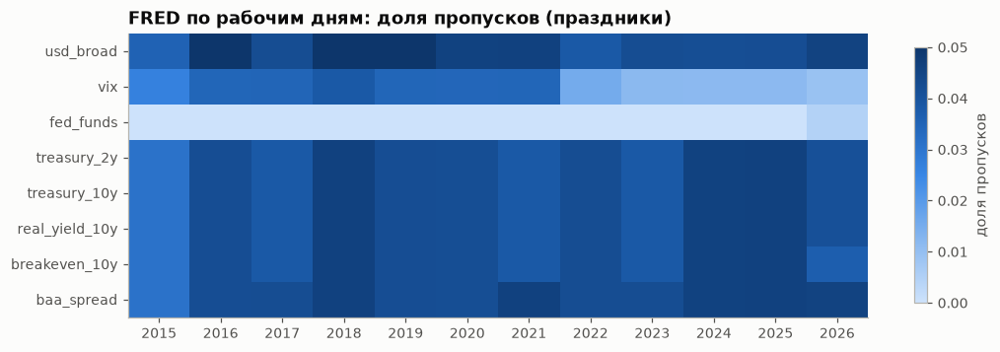

## 1.2. Ошибки и ограничения, найденные уже на первом этапе

| Блок | Что обнаружено | Следствие |
|---|---|---|
| Myfxbook | нестандартные двойные публикации в 2022 и 2023 годах | нельзя всегда связывать одну дату публикации ровно с одной отчётной неделей |
| EIA weekly | некоторые ряды округлены; экспорт в 2015–2016 часто повторяет прошлое значение | часть краткосрочной вариации может быть искусственно сглажена |
| Barchart | `open_interest` пуст; объёмы у разных nearby подозрительно совпадают | открытый интерес исключается, объём нельзя считать независимым по каждому контракту |
| FRED | разные календари, пересмотры месячных данных | нужен явный учёт даты публикации и версии ряда |
| BSEE | ошибки дат, числовые поля строками, неполный последний месяц | до моделирования нужны фильтры качества и безопасный лаг публикации |
| EIA refineries | идентификаторы НПЗ нестабильны по годам | нельзя просто соединять всю историю по одному ключу |
| GEM | текущий снимок, сложные цепочки владения | нельзя напрямую трактовать суммы долей как обычные доли собственности |
| HURDAT2 | итоговая траектория шторма уточняется после события | подходит для разведочного анализа, но не для честной исторической модели |
| OSM | текущий снимок, нет исторических дат | можно использовать как географический справочник, но не как исторически точное состояние сети |

**Итог EDA 01.** Основные временные ряды пригодны для анализа, но объединять все таблицы «как есть» нельзя. Главная сложность не столько в количестве пропусков, сколько в **разном времени доступности данных, пересмотрах и снимках, которые описывают состояние на дату выгрузки, а не на историческую дату прогноза**.

---

# 2. EDA 02 — фундаментальные данные EIA

Ноутбук: [`../eda/notebooks/02_eia_fundamentals.ipynb`](../eda/notebooks/02_eia_fundamentals.ipynb)

Исходная таблица для этого раздела имеет размер **610 × 39** и покрывает отчётные недели с `2015-02-20` по `2026-10-23`.

## 2.1. Проверка целостности и единиц

Перед анализом зависимостей были проверены:

- недельная частота и последовательность дат;
- отсутствие полных дублей;
- совпадение самостоятельно рассчитанного `diff(crude_stocks)` с колонкой недельного изменения запасов;
- формула чистого импорта `imports − exports`;
- единицы измерения и перевод запасов из тыс. баррелей в млн баррелей;
- приближенный баланс потоков.

**Результат.** Ключевые расчётные зависимости согласуются. Пропуски в EIA weekly сосредоточены в первой строке производных колонок, где разность физически невозможно посчитать без предыдущей недели. Массовых пропусков или дублей не найдено.

При этом выявлены особенности самих официальных рядов:

- `crude_production` с июня 2018 по ноябрь 2024 округлена примерно до 100 тыс. барр./сут;
- `crude_exports` в 2015–2016 **61 неделю** повторяет предыдущее значение;
- единицы некоторых потоков не записаны непосредственно в итоговом parquet и восстанавливаются из кода сбора.

Это не делает ряд непригодным, но ограничивает интерпретацию небольших недельных изменений.

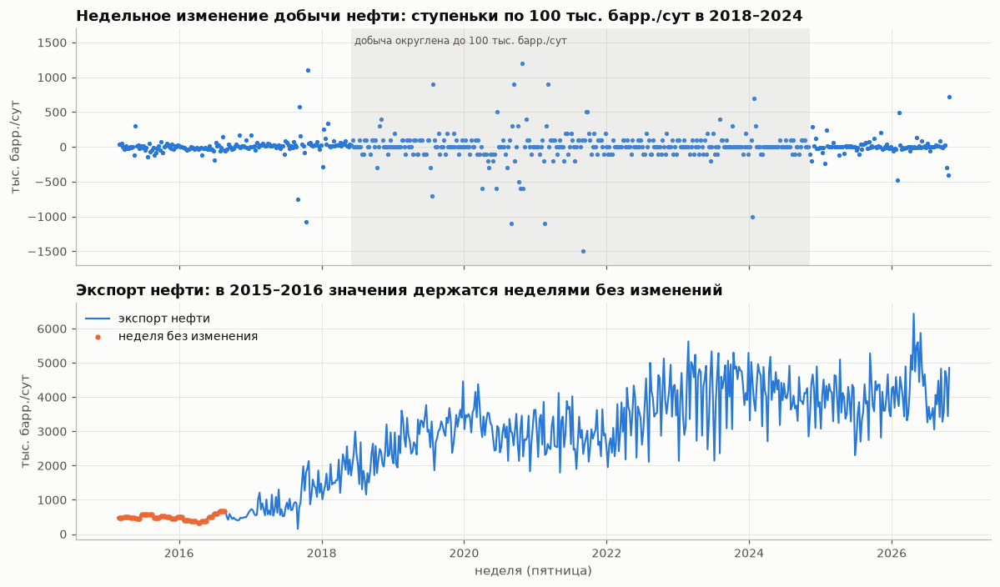

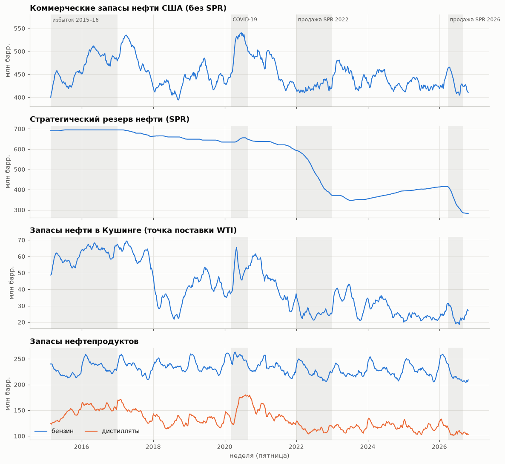

## 2.2. Какие регионы формируют изменение национальных запасов

Национальные коммерческие запасы были разложены на PADD-регионы и отдельно Cushing. Доля вклада оценивалась через ковариацию регионального изменения с национальным изменением.

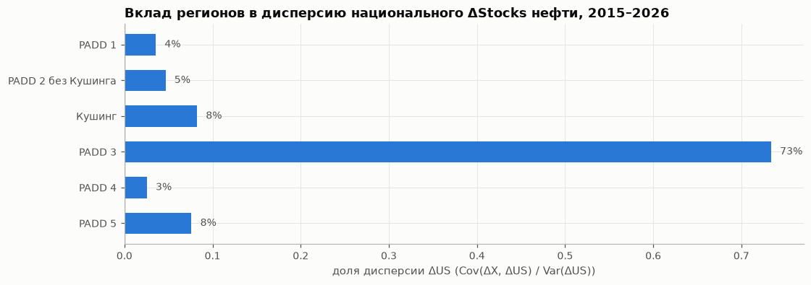

| Компонент | Вклад в вариацию национального ΔStocks |
|---|---:|
| PADD1 | 3.6% |
| PADD2 без Cushing | 4.7% |
| Cushing | 8.2% |
| **PADD3** | **73.4%** |
| PADD4 | 2.5% |
| PADD5 | 7.6% |

Корреляция изменения запасов PADD3 с национальным изменением составляет примерно **0.87**.

**Результат и смысл.** Основная недельная вариация национальных запасов приходится на PADD3 — побережье Мексиканского залива. Это физически правдоподобно: здесь сосредоточены крупные НПЗ, порты, экспортно-импортные потоки и хранилища. Однако результат нельзя трактовать как причинное утверждение «PADD3 вызывает 73% движения»: национальная величина сама является суммой региональных компонентов.

## 2.3. Сезонность

Сезонность оценивалась по неделе года, причём качество сезонной модели проверялось на периоде 2023+.

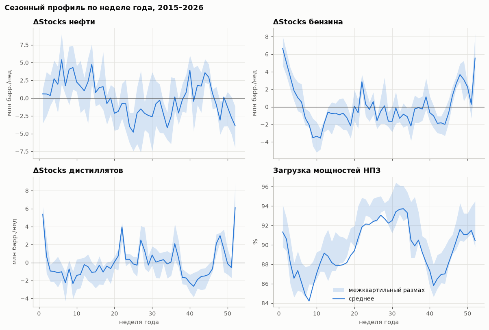

| Ряд | Доля вариации, объяснённая неделей года на периоде 2023+ |
|---|---:|
| Сырая нефть | **5.5%** |
| Бензин | 41.9% |
| Дистилляты | 28.7% |

Среднее изменение запасов сырой нефти по кварталам:

| Квартал | Средний ΔStocks, млн барр./нед. |
|---|---:|
| Q1 | +2.21 |
| Q2 | −0.69 |
| Q3 | −1.56 |
| Q4 | +0.27 |

**Результат и смысл.** У сырой нефти сезонность есть, но она значительно слабее, чем у бензина и дистиллятов. Для продуктов сильнее работают устойчивые циклы спроса и работы НПЗ; сырая нефть дополнительно зависит от экспорта, импорта, прихода танкеров и решений о хранении. Поэтому простая неделя года не может быть сильным самостоятельным прогнозом недельного изменения crude stocks.

## 2.4. Приближенный физический баланс

Был рассчитан показатель:

$$
ApproxBalance_t = (Production_t + Imports_t - Exports_t - RefineryInputs_t)\times 7.
$$

После перевода в млн баррелей он сравнивался с фактическим недельным изменением коммерческих запасов.

Средняя разница между приближенным балансом и фактическим изменением составляет примерно **−3.55 млн баррелей в неделю**.

**Результат и смысл.** Большая постоянная невязка не является признаком того, что формула «сломана». В неё сознательно не включены все статьи баланса EIA — в частности, `adjustment`, движения SPR и некоторые другие компоненты. Поэтому этот показатель нужно использовать как **сжатую характеристику наблюдаемых потоков**, а не как точное бухгалтерское тождество.

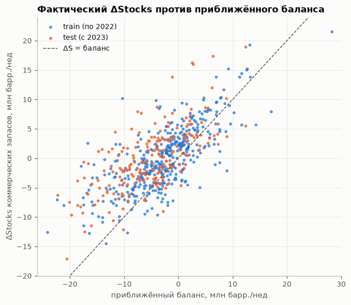

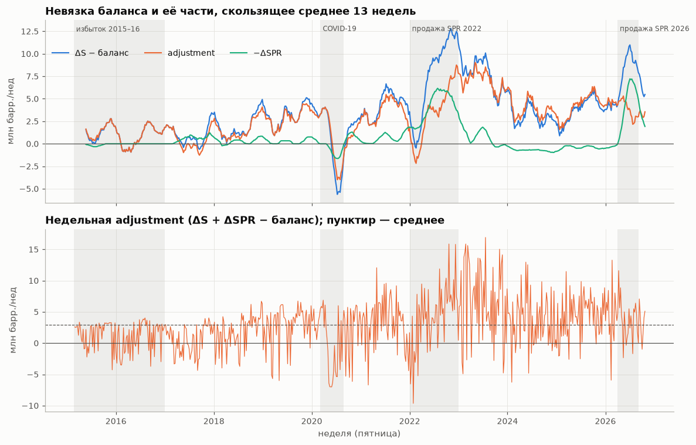

## 2.5. Лаговые фундаментальные признаки

Чтобы не использовать данные текущей недели, которые публикуются одновременно с целевой величиной, проверялись только уже известные лаги.

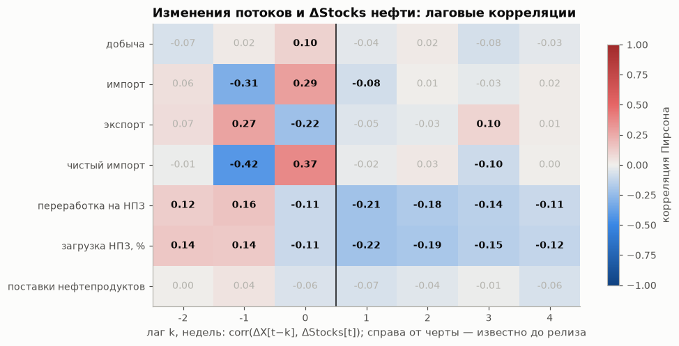

Пример результатов на периоде 2023+:

| Признак | Корреляция со следующим ΔStocks |
|---|---:|
| ΔCrude[t−1] | +0.166 |
| Приближенный баланс[t−1] | +0.305 |
| ΔCushing[t−1] | +0.272 |
| Изменение загрузки НПЗ[t−1] | −0.175 |
| Изменение загрузки НПЗ за 4 недели | −0.254 |
| Уровень загрузки НПЗ[t−1] | **−0.339** |
| Импорт[t−1] | +0.024 |
| Экспорт[t−1] | −0.067 |

**Результат и смысл.** Наиболее понятный физический сигнал дают НПЗ: чем выше переработка сырой нефти, тем больше нефти забирается из коммерческих запасов, поэтому знак отрицательный. При этом даже корреляция около −0.34 остаётся умеренной и относится к **фактическому ΔStocks**, а не к ошибке ожиданий относительно консенсуса.

## 2.6. Базовые прогнозы фактического изменения запасов

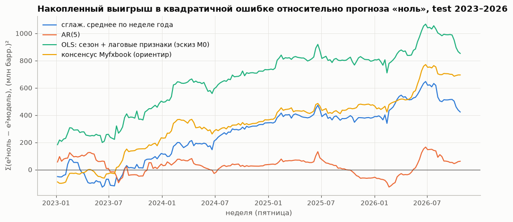

| Модель | MAE | RMSE | Верное направление |
|---|---:|---:|---:|
| Нулевой прогноз | 4.230 | 5.434 | — |
| Предыдущая неделя | 5.363 | 7.017 | 56.3% |
| Среднее по неделе года | 4.016 | 5.282 | 62.8% |
| Сглаженная сезонность | 3.941 | 5.235 | 64.3% |
| AR(5) | 4.070 | 5.406 | 55.3% |
| Сезонность + AR | 4.102 | 5.386 | 59.3% |
| МНК: сезонность + лаги | 3.857 | 5.025 | 66.3% |
| **Консенсус** | **3.699** | **5.020** | **66.7%** |

**Результат.** Консенсус аналитиков лучше простых моделей на истории EIA. Это важный итог второго EDA: прогнозировать только фактическое изменение запасов недостаточно интересно — значительная часть простой предсказуемости уже присутствует в ожиданиях рынка.

---

# 3. EDA 03 — целевая переменная, консенсус и API

Ноутбук: [`../eda/notebooks/03_inventory_surprise.ipynb`](../eda/notebooks/03_inventory_surprise.ipynb)

Основная обработанная таблица Myfxbook содержит **616 публикаций** с `2015-01-07` по `2026-11-04`, без пустых ячеек и полных дублей. К ней добавляются текущая история EIA и недельные оценки API.

Целевая величина:

$$
Surprise_t = Actual_t - Consensus_t.
$$

Положительное значение означает больший рост запасов / меньшее снижение, чем ожидалось; отрицательное — более сильное сокращение запасов, чем ожидал рынок.

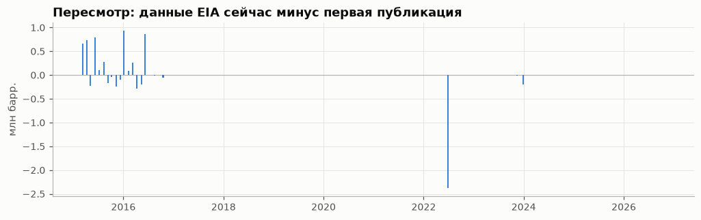

## 3.1. Консенсус против фактического изменения

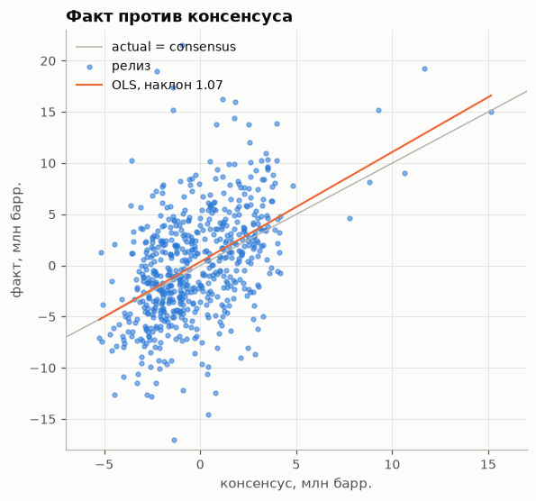

По всей обработанной выборке:

| Показатель | Значение |
|---|---:|
| Corr(Actual, Consensus) | ≈ 0.48 |
| R² линейной связи | ≈ 0.23 |
| Наклон регрессии | ≈ 1.07 |
| Свободный член | ≈ +0.36 млн барр. |
| std(Actual) | ≈ 5.38 млн барр. |
| std(Consensus) | ≈ 2.40 млн барр. |

**Результат и смысл.** Консенсус улавливает часть движения, но заметно сглаживает экстремальные недели: фактический ряд более чем вдвое волатильнее прогнозного. Поэтому крупные ошибки ожиданий — не редкая техническая мелочь, а важная часть целевой переменной.

## 3.2. Изменение качества консенсуса по годам

В 2015 и 2017 годах корреляция `Actual–Consensus` находилась примерно в диапазоне **0.64–0.71**, тогда как в 2023–2026 — примерно **0.35–0.39**.

**Результат и смысл.** Информативность ряда Myfxbook снизилась в последние годы. Это нельзя автоматически переводить в утверждение «аналитики стали хуже»: одновременно изменилась волатильность нефтяного баланса, выросла роль экспорта, были COVID, продажи SPR и геополитические шоки; кроме того, состав и методика агрегирования консенсуса Myfxbook могли меняться.

## 3.3. Распределение ошибки ожиданий

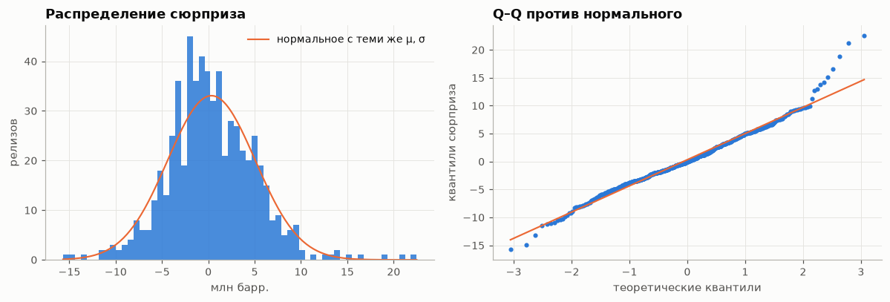

| Статистика | Значение |
|---|---:|
| Наблюдений | 616 |
| Среднее | +0.337 млн барр. |
| Медиана | −0.002 млн барр. |
| Стандартное отклонение | 4.728 млн барр. |
| Асимметрия | +0.41 |
| Эксцесс | 1.80 |
| t-тест среднего = 0 | p = 0.078 |
| Доля `|surprise| > 5` | ≈ 26% |
| Доля `|surprise| > 10` | ≈ 3.2% |

Нормальность распределения отвергается; хвосты существенно тяжелее нормального распределения.

**Результат и смысл.** Постоянного статистически убедительного смещения вверх или вниз не найдено, но крупные ошибки происходят регулярно. Поэтому при оценке моделей разумно уделять внимание MAE, медианной абсолютной ошибке, устойчивым потерям и качеству на экстремальных неделях, а не только MSE.

## 3.4. Ошибка ожиданий во времени и автокорреляция

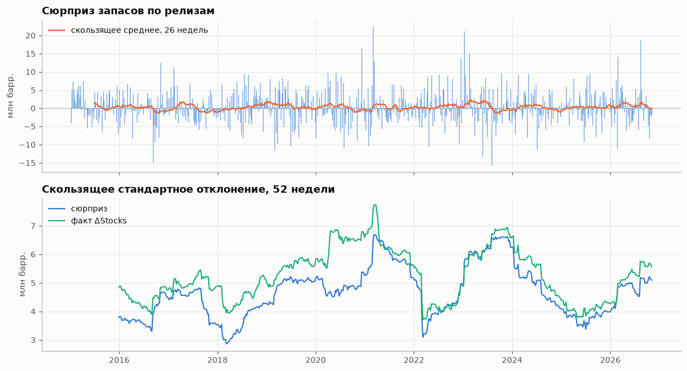

Приблизительные автокорреляции:

| Лаг | Корреляция |
|---:|---:|
| 1 | −0.02 |
| 2 | +0.04 |
| 4 | +0.08 |
| 8 | −0.09 |
| 13 | +0.03 |
| 26 | +0.03 |
| 52 | −0.01 |

Тест Ljung–Box на исследованных лагах не обнаруживает выраженной линейной автокорреляции. Сезонность по неделе года также незначима.

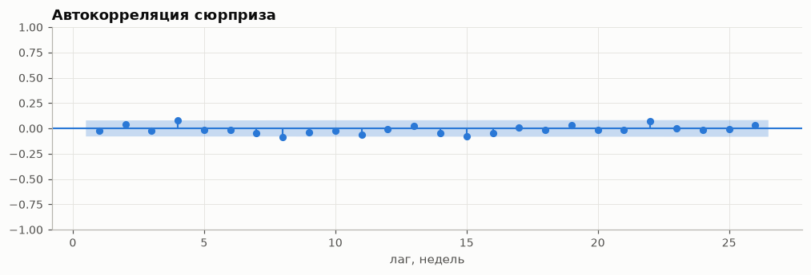

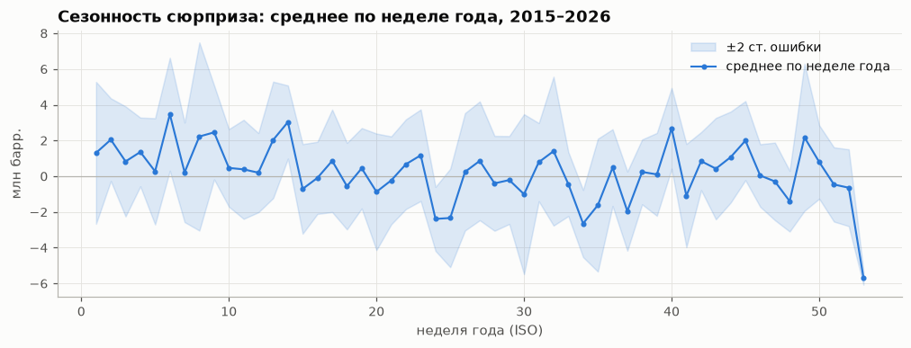

**Результат и смысл.** Целевая переменная почти не имеет простой собственной памяти. Это ожидаемо: если аналитики уже используют прошлые запасы и сезонность, после вычитания консенсуса остаётся в основном неожиданная часть движения. Отсутствие линейной автокорреляции не означает, что целевая величина вообще непредсказуема — внешние события всё ещё могут содержать сигнал.

## 3.5. API как оценка той же физической недели

Главный результат EDA 03 — высокая связь между `API − Consensus` и итоговой ошибкой ожиданий EIA.

| Показатель | Результат |
|---|---:|
| Corr(`API − Consensus`, `EIA − Consensus`) | ≈ 0.715 |
| R² | ≈ 0.511 |
| Верный знак | ≈ 73.5% недель |
| MAE API как прогноза Actual на периоде 2023+ | ≈ 2.87 |
| MAE Consensus как прогноза Actual на периоде 2023+ | ≈ 3.67 |
| MAE `API − Consensus` как прогноза Surprise | ≈ 2.70 |
| MAE с добавлением исторических признаков | ≈ 2.67 |

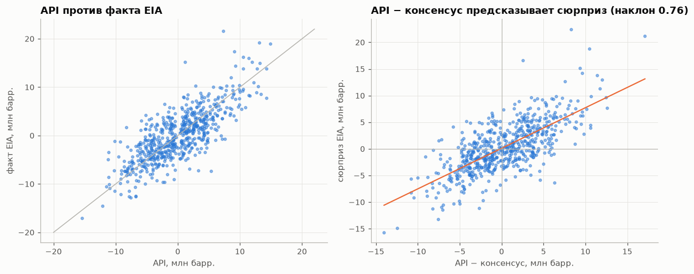

**Почему результат такой сильный.** API и EIA оценивают один и тот же физический баланс одной и той же недели. Если записать

$$
Y = EIA - Consensus,
$$

то

$$
API - Consensus = Y + (API - EIA).
$$

То есть `API − Consensus` по построению является шумной предварительной оценкой целевой величины. Поэтому высокий R² сам по себе не выглядит подозрительно.

**Практический вывод.** Любая модель на новостях должна сравниваться не только с нулевым прогнозом или лагами EIA, а с сильной базовой моделью, в которой уже присутствует API.

## 3.6. Проблемы выравнивания Myfxbook, найденные после EDA

В исходном JSON Myfxbook после 2015 года содержится **618 записей**, а в обработанной таблице — **616**. Причина — две даты, в которые в один день публиковались данные сразу за две отчётные недели:

- `2022-06-29`;
- `2023-11-15`.

При преобразовании «дата публикации → предыдущая пятница» такие двойные публикации нельзя корректно представить одним правилом. В 2022 году у второй записи отсутствует консенсус, поэтому полноценный target всё равно не получается. В 2023 году у обеих записей консенсус есть, поэтому одна валидная целевая строка действительно потеряна.

**Следствие.** Основные выводы EDA не меняются, но перед финальным моделированием нужно восстановить нестандартные публикации и строить календарные лаги через явное соответствие отчётным неделям, а не через положение строки.

---

# 4. EDA 04 — фьючерсная кривая WTI и реакция рынка

Ноутбук: [`../eda/notebooks/04_wti_curve_spread.ipynb`](../eda/notebooks/04_wti_curve_spread.ipynb)

Основные таблицы:

| Таблица | Размер | Период | Пропуски |
|---|---:|---|---:|
| `barchart_wti_curve_2015_onward.parquet` | 2 981 × 27 | 2015-01-02 — 2026-11-05 | 0.0% |
| `barchart_wti_nearbys_2015_onward.parquet` | 20 867 × 14 | 2015-01-02 — 2026-11-05 | 7.1% |
| `eia_wti_futures_features_2015_2024.parquet` | 2 305 × 11 | 2015-02-19 — 2024-04-05 | 0.0% |

## 4.1. Проверка качества Barchart

Обнаружено несколько существенных особенностей:

- `open_interest` отсутствует во всех **20 867** строках nearbys;
- объём торгов подозрительно одинаков у разных nearby-контрактов;
- смена ближайшего контракта происходит обычно за **2–8 торговых дней** до экспирации, чаще около четырёх;
- отрицательная цена WTI `−37.63` от 20 апреля 2020 года в этом ряду не представлена;
- данные EIA по фьючерсам заканчиваются `2024-04-05`, поэтому годятся для проверки части периода, но не для полного покрытия 2025–2026;
- в EIA futures найдены 18 праздничных строк с ценой прошлого торгового дня и 12 пропущенных торговых дней.

**Результат.** Ряд Barchart пригоден для анализа, но его нельзя использовать без специальной обработки смены контрактов и безоговорочного доверия к `volume/open_interest`.

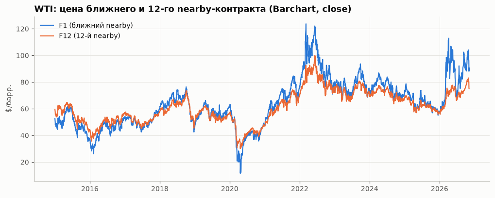

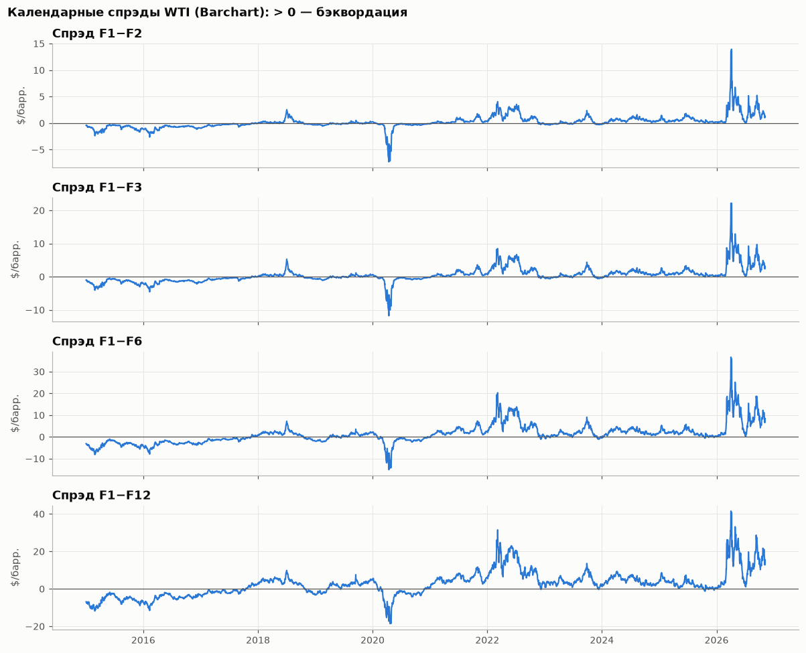

## 4.2. Загрязнение изменений спрэда сменой контрактов

Если просто считать дневное изменение `F1 − F2`, то в день смены ближайшего контракта сравниваются разные пары контрактов.

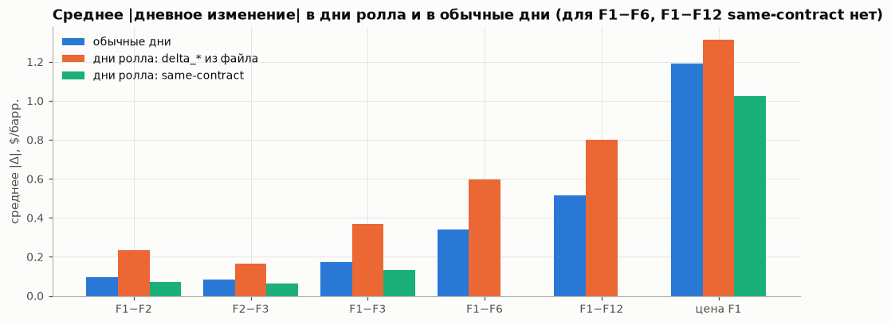

| Тип дня | Среднее `|Δ(F1−F2)|` |
|---|---:|
| День смены контракта | ≈ $0.234 |
| Обычный день | ≈ $0.095 |
| После перехода к одной и той же паре контрактов | ≈ $0.071 |

Дни смены составляют около **4.8%** наблюдений, но дают примерно **14.7% суммы квадратов** исходных изменений спрэда.

**Результат и смысл.** Значительная часть экстремальных изменений исходного `delta_spread` является технической, а не рыночной. Поэтому для дальнейшего анализа сформирован `curve_clean.parquet`, где изменение считается только между днями с одной и той же парой контрактов.

## 4.3. Уровень спрэда и запасы Cushing

Получено:

```text
Spearman(F1−F2, Cushing stocks) ≈ −0.83
Spearman(Δ(F1−F2), ΔCushing)    ≈ −0.12
```

**Результат и смысл.** Уровень календарного спрэда очень тесно связан с физическим режимом запасов в пункте поставки: низкие запасы Cushing соответствуют более сильной бэквордации. Но недельные изменения обеих величин намного шумнее, поэтому сильная связь уровней не превращается в сильную связь первых разностей.

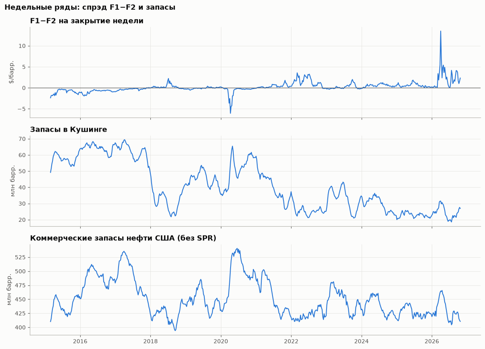

## 4.4. Реакция рынка на публикацию EIA

Для дневного изменения очищенного спрэда:

$$
\Delta(F1-F2) = \alpha + \beta\,Surprise + \varepsilon.
$$

Получено:

| Зависимость | Коэффициент | p-value | Вывод |
|---|---:|---:|---|
| `Δ(F1−F2)` от Surprise | ≈ −0.0016 $ / 1 млн барр. | ≈ 0.35 | величина практически нулевая |
| `ΔF1` от Surprise | ≈ −0.035 $ / 1 млн барр. | ≈ 0.02 | слабая, но статистически заметная реакция |
| `ΔF1` от `API−Consensus` | ≈ −0.043 | ≈ 0.013 | заметнее |
| `ΔF1` от `Actual−API` | ≈ −0.020 | ≈ 0.39 | убедительной связи нет |

Для спрэда R² около **0.0005**. Ожидаемое направление реакции совпадает примерно в **55%** релизов; это больше случайных 50%, но экономическая величина реакции остаётся очень небольшой.

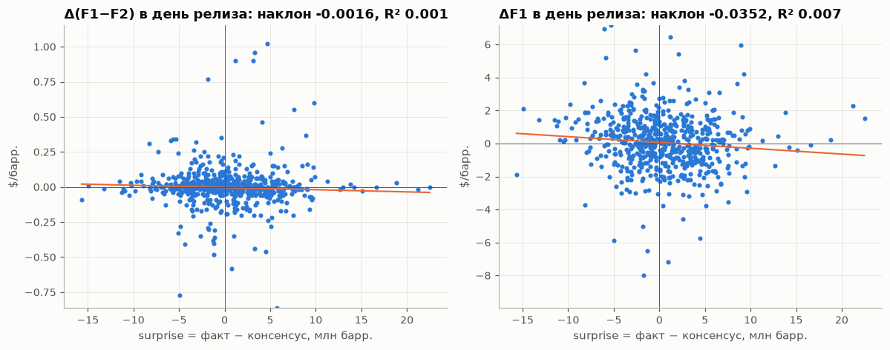

**Почему результат мог получиться слабым.** EIA выходит около 10:30 ET, а анализ использует дневные цены. Между предыдущей и текущей расчётной ценой происходит много других событий, а краткосрочная реакция на EIA может частично откатиться. Кроме того, национальные запасы не являются единственным фактором календарного спрэда, а F1 и F2 могут двигаться почти параллельно.

**Вывод EDA 04.** Текущие дневные данные не подтверждают сильную линейную реакцию `F1−F2` на surprise. Для проверки торговой гипотезы нужны внутридневные котировки отдельных контрактов вокруг времени публикации EIA.

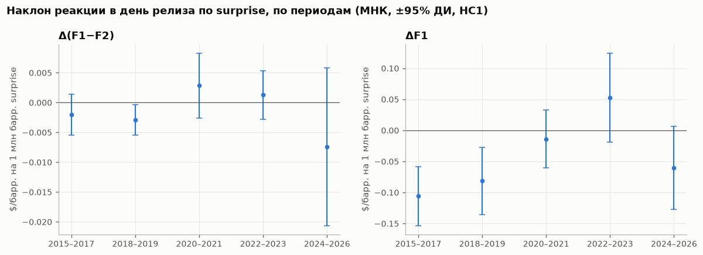

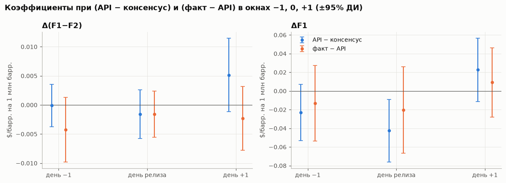

---

# 5. EDA 05 — макроэкономические данные FRED

Ноутбук: [`../eda/notebooks/05_fred_macro.ipynb`](../eda/notebooks/05_fred_macro.ipynb)

| Таблица | Размер | Период | Пропуски |
|---|---:|---|---:|
| `fred_daily_features.parquet` | 4 276 × 28 | 2015-02-19 — 2026-11-03 | 27.0% ячеек |
| `fred_monthly_features_current.parquet` | 140 × 7 | 2015-02 — 2026-09 | 3.1% ячеек |

## 5.1. Откуда берутся пропуски

Для дневной таблицы значительная доля пустых значений связана с разными календарями публикации и торговыми праздниками. На рабочих днях выделено **147 из 3 054** дат с отсутствующим VIX или широким долларовым индексом. Частые даты совпадают с праздниками США.

Кроме того:

- широкий долларовый индекс публикуется не каждый день и заканчивается `2026-10-30`;
- VIX имеет пропуски на части праздничных дат;
- CPI и безработица пусты за `2025-10` в текущей месячной таблице;
- месячная таблица хранит **текущую пересмотренную историю**, а не исторические версии публикаций.

**Результат.** Заполнять такие пропуски обычной интерполяцией нельзя. При недельной агрегации используется последнее значение, которое уже было известно к нужной дате.

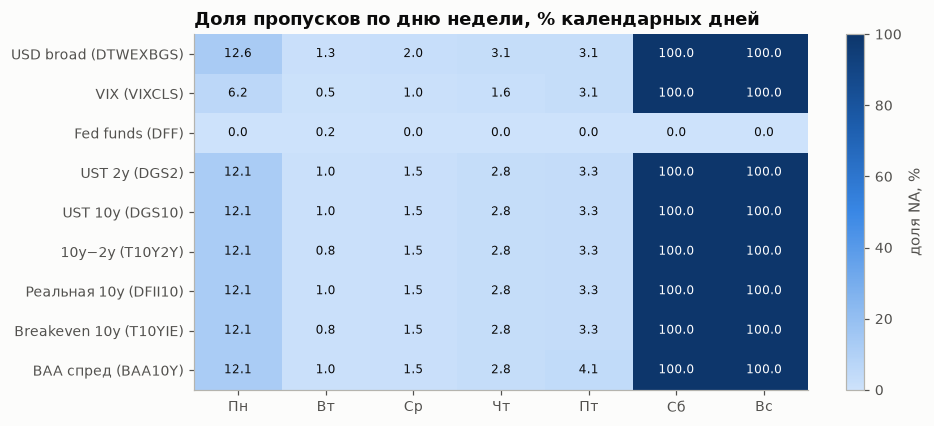

## 5.2. Внутренние проверки рядов

Проверены расчетные зависимости:

$$
T10Y2Y = DGS10 - DGS2,
$$

$$
T10YIE = DGS10 - DFII10.
$$

Они совпадают с производными рядами практически точно.

**Результат.** Основные процентные и спредовые показатели собраны согласованно; при этом включать одновременно исходные доходности и их точные разности без необходимости не стоит из-за избыточности признаков.

## 5.3. Связь макроэкономики с целевой переменной

Почти все недельные изменения макроэкономических показателей имеют абсолютную корреляцию с surprise не выше примерно **0.05–0.06**.

**Результат.** Макроэкономические показатели практически не объясняют ошибку ожиданий по запасам. Это логично: доллар, ставки и VIX прежде всего воздействуют на цены финансовых активов, тогда как surprise — остаток физического недельного баланса после вычитания уже сформированного консенсуса.

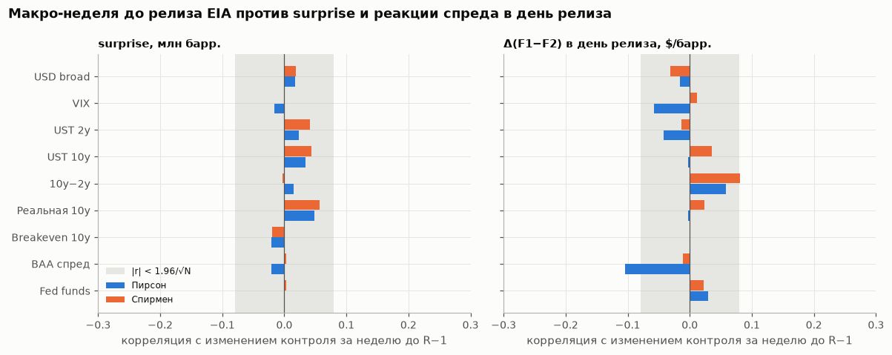

## 5.4. Связь макроэкономики с ценой WTI

Связь с рыночной ценой заметно сильнее. Например, корреляция инфляции безубыточности с WTI составляет около **0.34**.

В 2026 году выделяется отдельный режим: WTI доходил примерно до **$112.95**, `F1−F2` — примерно до **$13.94**, а знаки некоторых связей WTI с долларом и VIX менялись относительно более раннего периода.

**Результат и смысл.** FRED полезнее как описание общего рыночного режима и как контрольные признаки в анализе цены, чем как самостоятельный прогноз ошибки ожиданий по запасам.

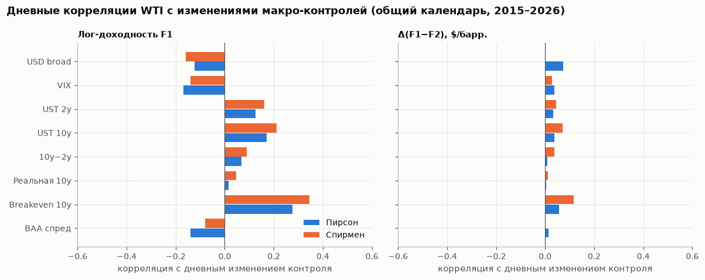

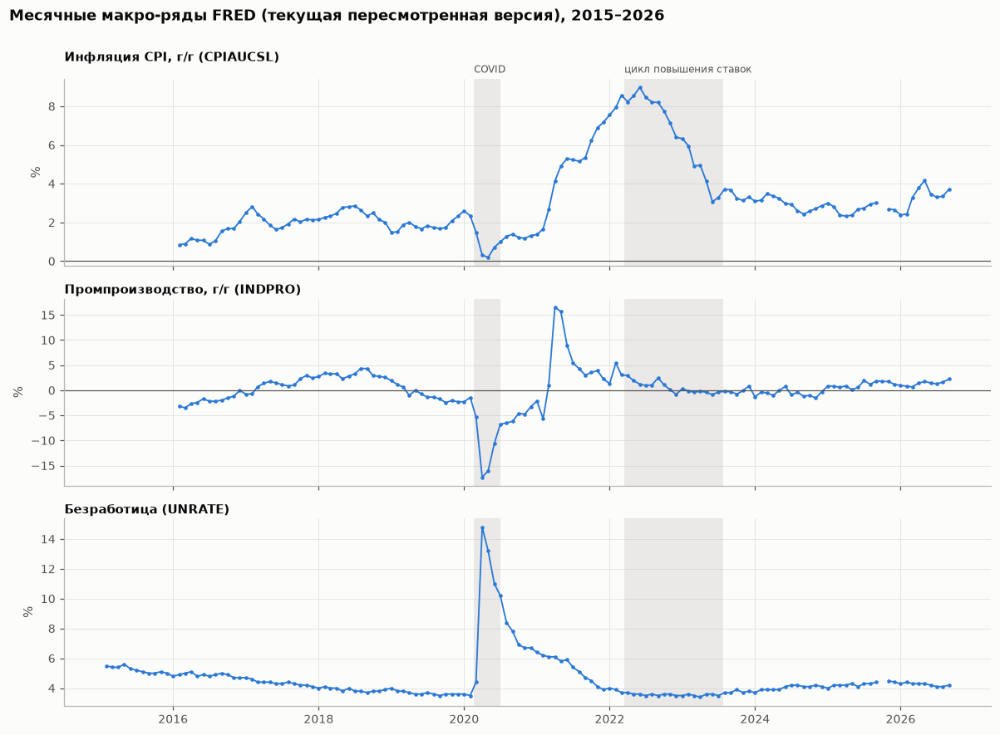

## 5.5. Мультиколлинеарность

Для компактного набора контролей — широкий долларовый индекс, VIX, двухлетняя ставка, 10-летняя инфляция безубыточности и BAA-спред — максимальный VIF составляет около **1.53**. При добавлении реальной 10-летней доходности он растёт примерно до 3.

**Результат.** После отбора компактного набора сильной мультиколлинеарности нет. Основная проблема FRED для итоговой модели — не корреляция признаков между собой, а исторические версии месячных данных и точный момент их доступности.

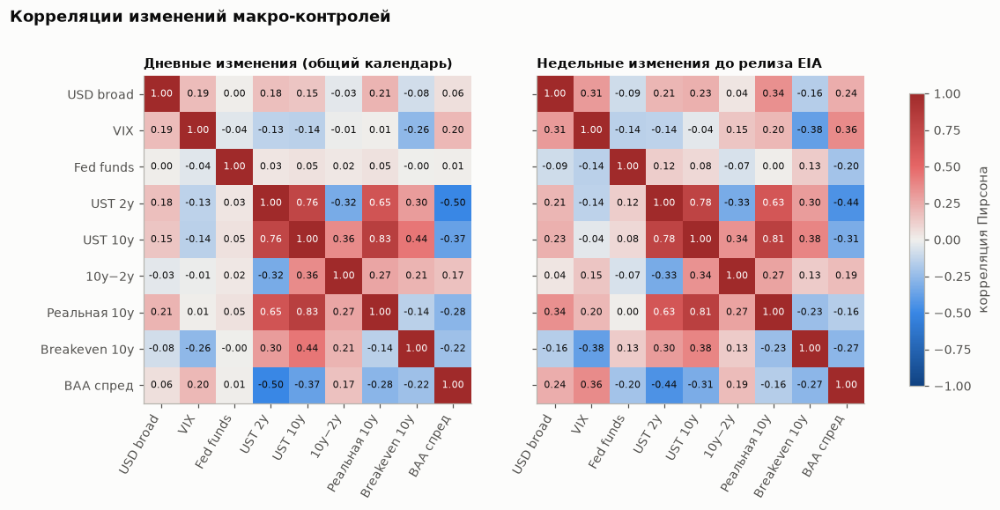

---

# 6. EDA 06 — инфраструктура и погодные события

Ноутбук: [`../eda/notebooks/06_infrastructure.ipynb`](../eda/notebooks/06_infrastructure.ipynb)

Этот раздел отличается от предыдущих: большая часть таблиц здесь не является готовыми недельными признаками. Цель EDA — проверить качество инфраструктурных сущностей и понять, дают ли физические события измеримый эффект, который впоследствии можно связывать с новостями.

## 6.1. Качество инфраструктурных таблиц

Ключевые размеры и пропуски:

| Таблица | Строк | Пропусков, % | Что важно |
|---|---:|---:|---|
| `bsee_production_by_complex_month_2015plus` | 150 465 | 0.0 | помесячная добыча по комплексам |
| `bsee_production_by_structure_2015plus` | 159 917 | 4.8 | помесячная добыча по сооружениям |
| `bsee_offshore_crude_pipelines` | 7 030 | 34.0 | много необязательных технических полей |
| `bsee_offshore_pipelines` | 21 314 | 31.5 | то же |
| `bsee_pipeline_history_events` | 85 139 | 16.7 | история изменений трубопроводов |
| `bsee_platform_history` | 7 092 | 7.1 | история платформ |
| `eia_refineries_model_ready` | 1 561 | 0.2 | годовые данные НПЗ |
| `gem_entities` | 28 741 | 55.1 | много необязательных описаний |
| `gem_pipeline_ownership_all` | 23 996 | 8.4 | 69 полных дублей |
| `nhc_hurdat2_atlantic_2015_2025` | 6 223 | 0.0 | итоговые траектории штормов |
| `osm_oil_storage_tank_candidates` | 18 470 | 22.1 | текущие кандидаты резервуаров |
| `osm_refinery_candidates` | 85 | 8.8 | текущие кандидаты НПЗ |

Для BSEE дополнительно найдены:

- **9 невозможных `history_date`** с годами вне реалистичного диапазона;
- **10 сегментов** с `aban_date` около 1870 года;
- полностью пустая колонка `prpsl_con_dt`;
- около **34 числовых колонок**, сохранённых строками;
- сентябрь 2026 года по добыче неполный;
- в общих таблицах присутствуют не только Мексиканский залив, но и Тихий океан/Аляска.

**Результат.** Инфраструктурные данные нельзя напрямую подавать в модель после простого объединения. Они требуют очистки типов, фильтрации географии, проверки дат и явной временной валидности объектов.

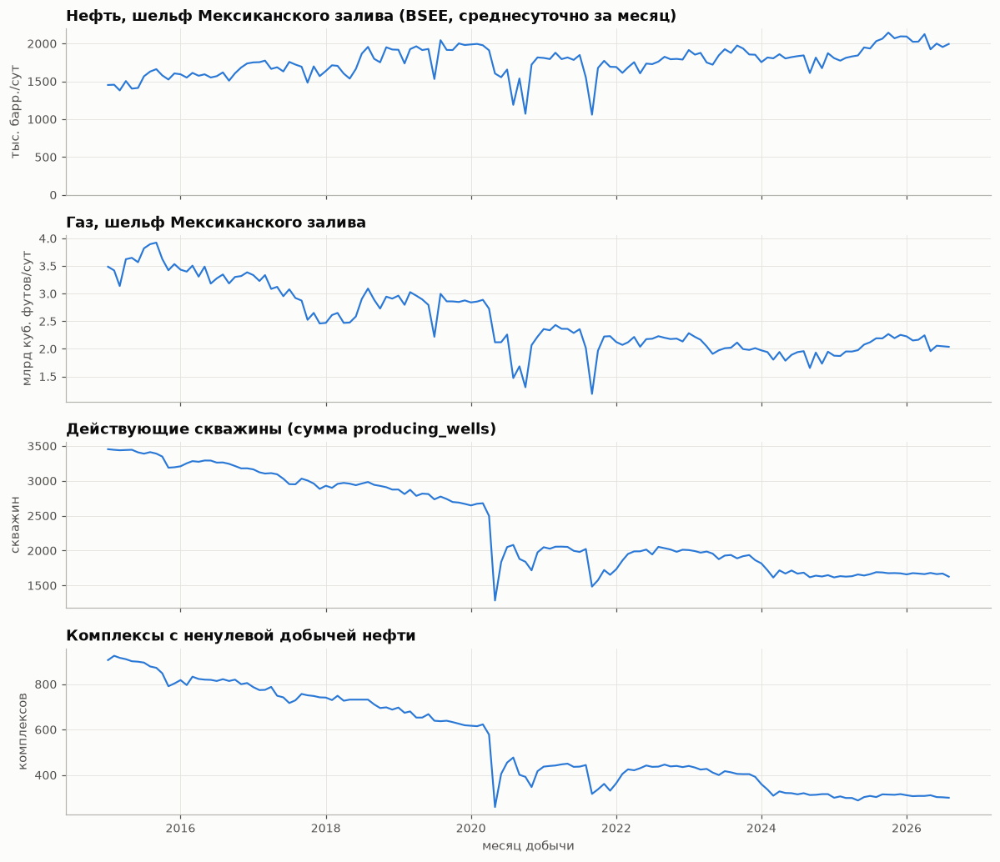

## 6.2. Ураганы и добыча в Мексиканском заливе

HURDAT2 был соединён с данными добычи, чтобы проверить физический эффект штормов.

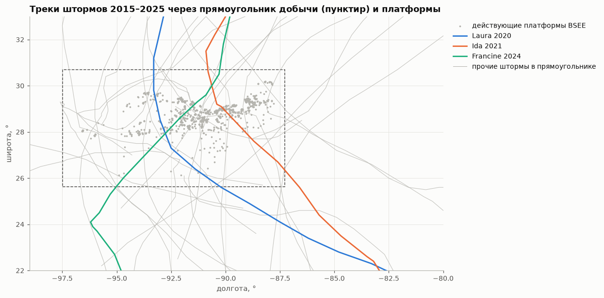

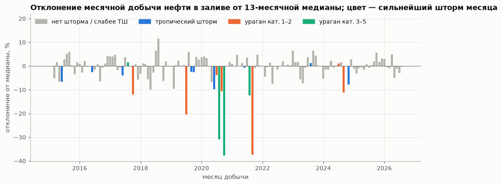

Среднее отклонение добычи от сезонной медианы:

| Класс события | Среднее отклонение добычи |
|---|---:|
| Тропический шторм | −3.50% |
| Ураган категории 1–2 | −13.48% |
| Ураган категории 3–5 | **−19.83%** |

В наиболее тяжёлые месяцы снижение доходило примерно до **−37.7%**.

**Результат и смысл.** Сила шторма действительно связана с физическим снижением добычи. Это поддерживает идею событийных признаков: информация об урагане может быть полезна не потому, что текст «негативный», а потому что событие связано с конкретными объектами и измеримым выпадением добычи.

## 6.3. Разбор крупных штормов

| Событие | Минимальное отклонение добычи EIA | Недобор EIA за 0–5 недель | Недобор BSEE |
|---|---:|---:|---:|
| Laura 2020 | −1100 kb/d | 14.7 млн барр. | 22.0 млн барр. |
| Delta 2020 | −925 kb/d | 13.3 млн барр. | 20.1 млн барр. |
| Ida 2021 | −1400 kb/d | **27.3 млн барр.** | **25.8 млн барр.** |
| Francine 2024 | −125 kb/d | 1.9 млн барр. | 6.0 млн барр. |

**Результат.** Масштаб эффекта сильно различается между событиями; категория урагана сама по себе не полностью определяет экономический ущерб. Для будущего графа важны траектория, затронутые платформы/порты/НПЗ и длительность остановки.

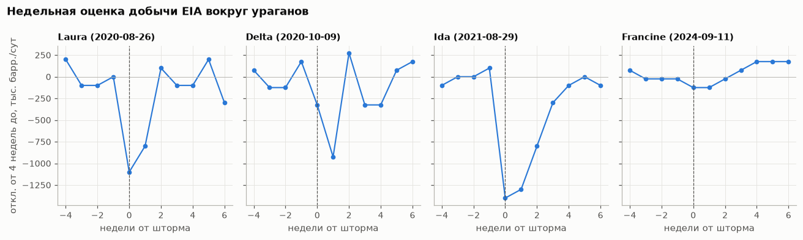

## 6.4. Доля добычи Мексиканского залива

Доля Gulf of Mexico в общей добыче США снижалась примерно с **18.3% в 2016 году** до **13.5% в 2024-м** и около **14.4% в 2025-м**.

**Результат.** Один и тот же абсолютный объём остановленной морской добычи в разные годы имеет разный относительный вес в национальном балансе. Поэтому эффект события желательно нормировать на текущий масштаб добычи.

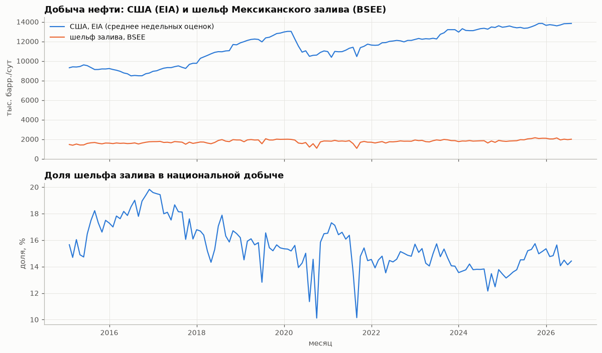

## 6.5. НПЗ, GEM и OSM

Для НПЗ EIA найдено около **239 уникальных `refinery_key`**, но только примерно **63** встречаются во всех годах. Координат в исходной таблице нет.

В GEM структура собственности представлена цепочками владения. Если механически суммировать доли по проекту, медианная сумма получается около **200%**, что показывает: строки не являются взаимоисключающими прямыми долями одного уровня.

OSM дал 18 470 кандидатов нефтехранилищ, но большая часть объектов не соответствует крупным коммерческим хранилищам, необходимым проекту; около Cushing найдено очень мало релевантных точек.

**Результат.** Для графа потребуются отдельные правила разрешения сущностей, а не простое объединение названий. GEM/OSM лучше использовать как справочный слой географии, пока не добавлена историческая валидность.

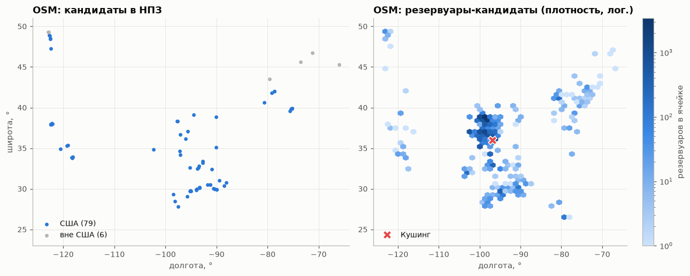

---

# 7. EDA 07 — единая недельная таблица

Ноутбук: [`../eda/notebooks/07_weekly_frame.ipynb`](../eda/notebooks/07_weekly_frame.ipynb)

Задача последнего EDA — собрать одну строку на публикацию EIA и посмотреть, что остаётся доступным перед релизом после применения временных лагов.

## 7.1. Размер и покрытие

Базовая таблица содержит **616 публикаций** и примерно 33 поля.

| Условие | Публикаций |
|---|---:|
| Есть целевая переменная | 616 |
| Достаточно основных признаков без обязательных BSEE/погодных полей | 604 |
| Полный набор признаков и результатов | 512 |

**Результат.** После объединения источников теряется заметная часть недель: полный пересекающийся набор составляет примерно 83% исходных релизов. Основная причина — разные периоды покрытия и лаги доступности, а не пропуски в самой целевой переменной.

## 7.2. Как учитывается время доступности

| Блок | Что берётся для публикации EIA недели t |
|---|---|
| История EIA | только t−1 и раньше |
| API | оценка, опубликованная до EIA |
| WTI / кривая | последнее доступное закрытие до выбранного момента прогноза |
| FRED daily | последнее уже опубликованное наблюдение с безопасным сдвигом |
| FRED monthly | требуется дата публикации; текущая пересмотренная история помечена как ограничение |
| BSEE | используется консервативный лаг не менее двух месяцев |
| НПЗ EIA | применён консервативный годовой лаг доступности |
| HURDAT2 | используется только для EDA, не считается безопасным историческим признаком |
| GEM/OSM | текущие снимки, не считаются исторически точным состоянием |

**Результат.** На уровне конструкции weekly frame основная защита от очевидной утечки соблюдается: потоки EIA той же недели не используются для прогнозирования собственного релиза. Но для нескольких источников остаётся утечка через пересмотренные версии или итоговые снимки, поэтому полный набор пока нельзя считать окончательно готовым для исторической проверки модели.

## 7.3. Какие признаки связаны с surprise после объединения

Главный результат итоговой таблицы:

> **`API − Consensus` остаётся единственным действительно сильным не новостным признаком.**

Для большинства остальных признаков абсолютная ранговая корреляция с surprise находится примерно в пределах **0.12**. После строгой поправки на множественные проверки API остаётся явным лидером.

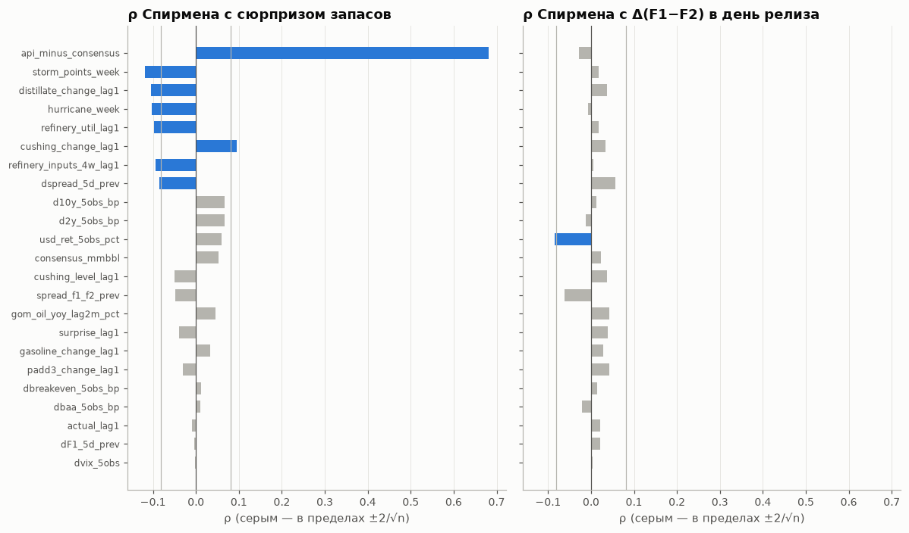

**Результат и смысл.** Большое число таблиц не означает автоматического прироста качества. После вычитания консенсуса простые лаги, макроэкономика и состояние рынка содержат мало прямого линейного сигнала. Это повышает планку для новостного блока: он должен добавлять информацию к API, а не только повторять уже известные физические признаки.

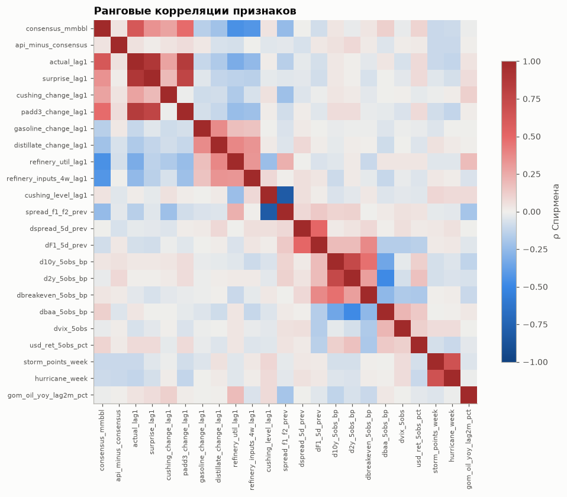

## 7.4. Недели с ураганами

| Состояние недели | Средний surprise |
|---|---:|
| Нет шторма | +0.45 млн барр. |
| Шторм без урагана | −1.46 млн барр. |
| Ураган | **−2.67 млн барр.** |

Для недель с ураганом:

- `n ≈ 14`;
- примерно **71%** ошибок ожиданий отрицательны;
- p-value теста Манна–Уитни против недель без штормов ≈ **0.012**.

**Результат и смысл.** В выборке недели с ураганами связаны с более отрицательной ошибкой ожиданий: запасы чаще оказываются «бычьими» относительно ожиданий. Это хороший пример события, которое потенциально может быть не полностью учтено аналитиками. Однако наблюдений всего около 14, а HURDAT2 содержит итоговую информацию о траектории, поэтому результат пока является разведочным, а не доказательством прогнозной силы.

---

# 8. Сводные выводы

| Что проверили | Результат | Что это означает |
|---|---:|---|
| Среднее surprise | +0.34 млн барр., p≈0.078 | устойчивого постоянного смещения консенсуса не видно |
| Хвосты surprise | эксцесс ≈1.8 | крупные ошибки встречаются чаще, чем при нормальном распределении |
| Автокорреляция surprise | близка к 0 | простой прогноз по прошлому surprise слаб |
| Сезонность surprise | статистически слабая | известная сезонность в значительной степени уже учтена в ожиданиях |
| Consensus → Actual | R²≈0.23 | консенсус информативен, но сильно сглаживает экстремумы |
| `API−Consensus` → Surprise | R²≈0.51; знак ≈73.5% | сильнейшая базовая информация перед EIA |
| PADD3 → national ΔStocks | вклад ≈73%; corr≈0.87 | Gulf Coast доминирует в вариации национальных запасов |
| Сезонность crude stocks | ≈5.5% вариации на 2023+ | заметно слабее бензина и дистиллятов |
| Лучшие лаги EIA | НПЗ / баланс, corr до ~0.3 | физика помогает Actual, но не обязательно surprise |
| Уровень `F1−F2` vs Cushing | Spearman≈−0.83 | форма кривой тесно связана с режимом хранения |
| Дневное `Δ(F1−F2)` vs Surprise | R²≈0.0005 | дневное окно слишком шумное для сильного событийного эффекта |
| FRED vs Surprise | `|r|≤0.06` | макроэкономика почти не объясняет остаточную ошибку ожиданий |
| Cat 3–5 hurricane vs GOM production | ≈−19.8% к сезонной медиане | ураганы имеют сильный измеримый физический эффект |
| Hurricane week vs Surprise | −2.67 против +0.45 млн барр. | есть перспективный событийный сигнал, но выборка мала |
| Полный weekly frame | 512 из 616 релизов | полное объединение источников уменьшает выборку примерно на 17% |

## Главный содержательный итог

Не новостные результаты складываются в логичную картину. Фундаментальные показатели EIA хорошо объясняют **сам физический баланс**, но после вычитания консенсуса большая часть простой предсказуемости исчезает. Макроэкономика почти не связана с целевой переменной. API остаётся сильным, потому что это отдельная оценка той же физической недели непосредственно перед EIA. События вроде ураганов, напротив, выглядят как пример информации, масштаб которой рынок может оценивать неполно.

Поэтому дальнейшая задача новостной части должна формулироваться строго: **проверить, добавляют ли события и связи между сущностями сигнал сверх API, консенсуса и доступных до релиза физических признаков**.

Более подробный анализ в ноутбуках по ссылкам.

---

# 9. Что нужно исправить перед моделированием

## 9.1. Myfxbook

1. Исправить разбор фактической структуры JSON `categories + series`.
2. Явно переводить числовые значения из баррелей в млн баррелей.
3. Не схлопывать двойные публикации по одной `release_date`.
4. Восстановить валидную дополнительную строку 15 ноября 2023 года.
5. Лаги `actual/surprise` строить по календарной отчётной неделе, а не обычным `shift(1)`.
6. Отдельно зафиксировать, когда именно исторический консенсус Myfxbook считался окончательным относительно публикации API.

## 9.2. Исторические версии данных

- EIA API содержит текущую историю, поэтому часть лаговых значений могла быть позднее пересмотрена.
- FRED monthly также содержит текущую пересмотренную историю; для строгой исторической проверки нужны версии ALFRED или аналогичная фиксация публикаций.
- HURDAT2 содержит итоговую траекторию после анализа шторма и не должен использоваться как исторически доступный признак.
- GEM и OSM — снимки современного состояния; объект должен иметь `valid_from/valid_to` или использоваться только как статичный географический справочник.

## 9.3. Рыночные данные

- Использовать только изменения одной и той же пары контрактов из `curve_clean.parquet`.
- Не использовать `open_interest` Barchart: поле пусто.
- Не интерпретировать одинаковый `volume` у nearbys как независимый объём каждого контракта.
- Для анализа реакции EIA получить внутридневные котировки примерно вокруг 10:30 ET.

## 9.4. Момент формирования прогноза

Нужно окончательно выбрать единую точку времени, например **10:25 ET в день публикации EIA**. Тогда для каждого признака можно формально проверять условие:

```text
available_at < prediction_timestamp
```

Это устранит неоднозначность между закрытием вторника, поздним API во вторник и информацией, появившейся утром среды.

---

## Графики

Все изображения в этом README **не строились отдельно**. Они извлечены непосредственно из сохранённых выводов ячеек ноутбуков `01_data_overview.ipynb` — `07_weekly_frame.ipynb`. Имена файлов содержат номер ноутбука и номер ячейки, поэтому исходный рисунок можно однозначно найти в соответствующем ноутбуке.
