# Разведочный анализ новостного корпуса

[Ноутбук](../eda/notebooks/08_news_corpus.ipynb) · [Автономный HTML](../eda/reports/news/news_eda.html) · [Сводка JSON](../eda/reports/news/summary.json) · [Расчёты](../eda/news_eda.py) · [EDA неновостных источников](eda.md)

Период публикаций с 01.01.2015 по 31.10.2026. Пересчёт от 2026-11-19 UTC охватывает 49 стран с текстами. Объём корпуса — 2 476 150 строк. Число уникальных текстов после проверок качества — 2 194 501. Объём выборки для проверки физических событий по заголовкам — 318 581.

В отчёт от 10 ноября 2026 года входили 460 460 статей из 31 коллекции. Проверяем, какие архивы удалось восстановить и связан ли недельный объём публикаций с сюрпризом запасов США. При уровне 5% после поправки на множественные сравнения статистически значимых результатов — 0 из 49.

## 1. Источники и учёт стадий сбора

Для 49 из 49 настроенных коллекций есть индекс и результаты фильтра по заголовку за все 142 месяца, а у каждого текущего кандидата найдена сохранённая попытка по story_id. Один материал может входить в несколько коллекций. До глобальной дедупликации строки суммируются по странам.

| Стадия | Число записей |
| --- | --- |
| Индекс Media Cloud | 9 441 450 |
| Отобрано классификатором заголовков | 4 801 407 |
| Кандидаты с сохранённой попыткой | 4 801 407 |
| Успешно извлечён текст | 2 676 698 |
| Строки собранного корпуса | 2 476 150 |
| Прошли проверки качества | 2 474 034 |
| Уникальные тексты после проверок | 2 194 501 |

Попытки охватили 100,0% кандидатов. До итоговой статьи дошли 51,6% попыток. На извлечении потеряно 2 124 709 публикаций, ещё 200 548 успешно извлечённых записей отсеяны при сборке.

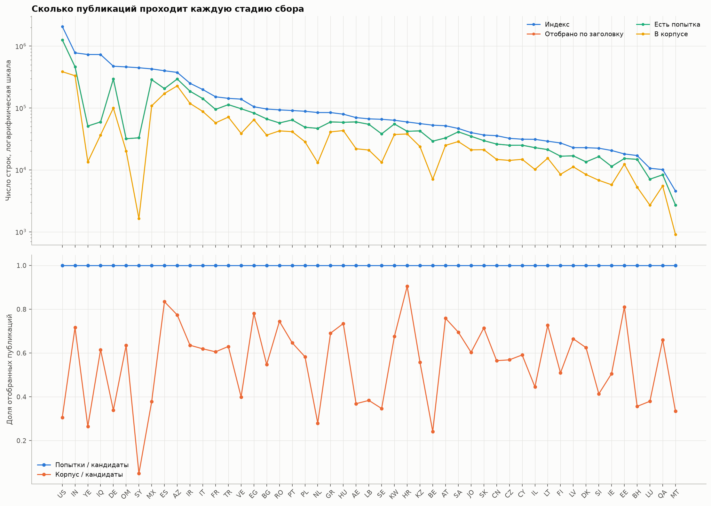

## 2. Географическое и временное покрытие

Код страны обозначает коллекцию издателей. Ирак, Оман, Сирия и Йемен собирались целиком в пределах выбранных коллекций Media Cloud. Для остальных стран индекс ограничивал предварительный поиск по тематическим терминам. Поэтому доля отобранных заголовков зависит и от способа сбора.

| Страна | Индекс | Кандидаты | Попытки | Статьи | Статьи / попытки |
| --- | --- | --- | --- | --- | --- |
| us | 2 074 729 | 1 261 928 | 1 261 928 | 385 650 | 30,6% |
| in | 777 158 | 463 120 | 463 120 | 331 775 | 71,6% |
| ye | 730 782 | 51 050 | 51 050 | 13 484 | 26,4% |
| iq | 729 639 | 59 566 | 59 566 | 36 641 | 61,5% |
| de | 472 232 | 294 467 | 294 467 | 99 784 | 33,9% |
| om | 460 419 | 31 840 | 31 840 | 20 207 | 63,5% |
| sy | 446 199 | 32 975 | 32 975 | 1 633 | 5,0% |
| mx | 427 503 | 286 248 | 286 248 | 108 309 | 37,8% |
| es | 399 158 | 205 583 | 205 583 | 171 555 | 83,4% |
| az | 375 503 | 293 693 | 293 693 | 227 345 | 77,4% |
| ir | 250 526 | 186 489 | 186 489 | 118 523 | 63,6% |
| it | 198 436 | 141 652 | 141 652 | 87 723 | 61,9% |
| fr | 151 564 | 94 874 | 94 874 | 57 451 | 60,6% |
| tr | 143 045 | 113 163 | 113 163 | 71 299 | 63,0% |
| ve | 138 881 | 97 168 | 97 168 | 38 823 | 40,0% |
| eg | 104 686 | 82 880 | 82 880 | 64 755 | 78,1% |
| bg | 96 154 | 66 505 | 66 505 | 36 405 | 54,7% |
| ro | 93 148 | 57 308 | 57 308 | 42 679 | 74,5% |
| pt | 90 929 | 64 056 | 64 056 | 41 425 | 64,7% |
| pl | 88 447 | 48 778 | 48 778 | 28 434 | 58,3% |
| nl | 84 382 | 46 860 | 46 860 | 13 114 | 28,0% |
| gr | 84 308 | 59 528 | 59 528 | 41 120 | 69,1% |
| hu | 79 336 | 58 714 | 58 714 | 43 143 | 73,5% |
| ae | 69 883 | 59 561 | 59 561 | 21 960 | 36,9% |
| lb | 66 718 | 54 468 | 54 468 | 20 894 | 38,4% |
| se | 65 612 | 38 150 | 38 150 | 13 219 | 34,7% |
| kw | 63 288 | 55 156 | 55 156 | 37 279 | 67,6% |
| hr | 59 430 | 42 002 | 42 002 | 38 014 | 90,5% |
| kz | 55 933 | 42 663 | 42 663 | 23 824 | 55,8% |
| be | 52 756 | 29 102 | 29 102 | 7 037 | 24,2% |
| at | 51 605 | 32 808 | 32 808 | 24 894 | 75,9% |
| sa | 46 641 | 41 222 | 41 222 | 28 668 | 69,5% |
| jo | 40 003 | 34 918 | 34 918 | 21 066 | 60,3% |
| sk | 36 600 | 29 664 | 29 664 | 21 200 | 71,5% |
| cn | 35 663 | 26 133 | 26 133 | 14 770 | 56,5% |
| cz | 32 333 | 24 999 | 24 999 | 14 222 | 56,9% |
| cy | 31 307 | 25 043 | 25 043 | 14 807 | 59,1% |
| il | 31 149 | 22 855 | 22 855 | 10 175 | 44,5% |
| lt | 29 044 | 21 280 | 21 280 | 15 459 | 72,6% |
| fi | 27 210 | 16 637 | 16 637 | 8 471 | 50,9% |
| lv | 22 859 | 16 868 | 16 868 | 11 218 | 66,5% |
| dk | 22 826 | 13 463 | 13 463 | 8 409 | 62,5% |
| si | 22 405 | 16 417 | 16 417 | 6 787 | 41,3% |
| ie | 20 564 | 11 363 | 11 363 | 5 750 | 50,6% |
| ee | 18 093 | 15 274 | 15 274 | 12 380 | 81,1% |
| bh | 17 052 | 14 801 | 14 801 | 5 274 | 35,6% |
| lu | 10 622 | 7 077 | 7 077 | 2 687 | 38,0% |
| qa | 10 124 | 8 332 | 8 332 | 5 505 | 66,1% |
| mt | 4 566 | 2 706 | 2 706 | 904 | 33,4% |

Хотя бы одна статья найдена во всех 142 месяцах для 35 коллекций. Из 6 958 пар «страна–месяц» статьи есть в 6 646. Помесячный индекс основан на дате Media Cloud, корпус — на итоговой дате статьи. Границы покрытия учитывают и пустые месяцы внутри многомесячных файлов.

Как часто архивная ссылка даёт текст, видно при группировке по исходной дате публикации. Обе величины ниже относятся к одной и той же когорте кандидатов. Вместе с возрастом ссылок меняется состав издателей, поэтому таблица сама по себе не устанавливает причину различий.

| Годы публикации | Попытки | Извлечены тексты | Успех извлечения |
| --- | --- | --- | --- |
| 2015–2018 | 1 096 411 | 457 258 | 41,7% |
| 2019–2022 | 1 915 823 | 1 028 625 | 53,7% |
| 2023–2025 | 982 406 | 618 166 | 62,9% |
| 2026, январь–октябрь | 806 767 | 572 649 | 71,0% |

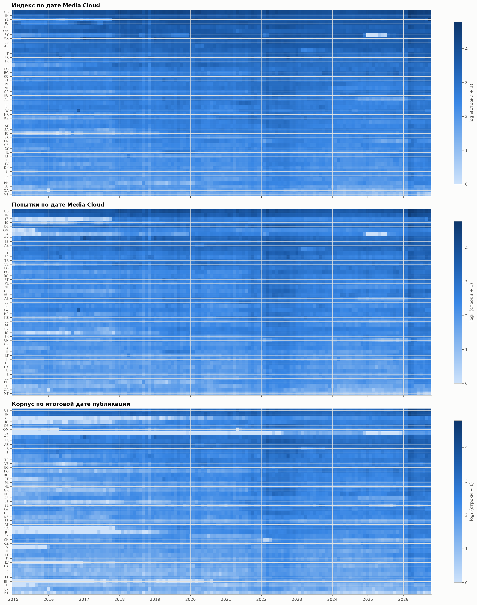

## 3. Ошибки загрузки и смещение выборки

При повторной загрузке берём последний результат по времени fetched_at внутри страны. HTTP 200 в таблице ошибок означает, что сервер ответил, но извлечь пригодный текст не удалось. HTTP-статус и причина обработки учитываются для одной и той же последней попытки.

| Причина | Неудачные попытки | Доля всех неудач |
| --- | --- | --- |
| HTTP 403 | 835 503 | 39,3% |
| HTTP 404 | 442 758 | 20,8% |
| Сеть / TLS | 195 506 | 9,2% |
| HTTP 200 | 162 420 | 7,6% |
| Тайм-аут | 158 535 | 7,5% |
| HTTP 429 | 112 668 | 5,3% |
| HTTP 410 | 45 882 | 2,2% |
| HTTP 401 | 40 534 | 1,9% |
| HTTP 451 | 33 083 | 1,6% |
| HTTP 503 | 22 039 | 1,0% |

Результаты десяти крупнейших издателей по числу кандидатов показывают, как различается восстановление текстов внутри коллекций. Сравнение долей учитывает дополнительную очистку после извлечения.

| Коллекция | Издатель Media Cloud | Кандидаты | Попытки | Статьи | Статьи / попытки |
| --- | --- | --- | --- | --- | --- |
| us | reuters.com | 114 895 | 114 895 | 17 | 0,015% |
| az | trend.az | 77 817 | 77 817 | 76 859 | 98,8% |
| in | indiatimes.com | 75 804 | 75 804 | 63 815 | 84,2% |
| in | business-standard.com | 44 363 | 44 363 | 44 127 | 99,5% |
| ir | mehrnews.com | 30 426 | 30 426 | 29 408 | 96,7% |
| us | marketbeat.com | 28 961 | 28 961 | 608 | 2,1% |
| ir | isna.ir | 27 798 | 27 798 | 0 | 0,0% |
| in | bhaskar.com | 26 981 | 26 981 | 22 048 | 81,7% |
| de | mk.ru | 26 504 | 26 504 | 8 244 | 31,1% |
| eg | youm7.com | 24 790 | 24 790 | 23 292 | 94,0% |

У Сирии в корпус вошли 1 633 из 32 975 обработанных кандидатов (5,0%). Низкое число текстов в такой коллекции особенно чувствительно к доступности сайтов.

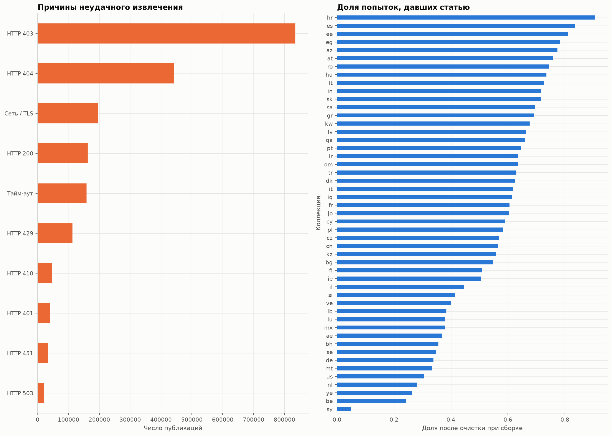

## 4. Языки и фильтр релевантности

В корпусе 40 языков. Таблица показывает двенадцать крупнейших групп. Один язык может встречаться в нескольких коллекциях.

| Язык | Статьи | Доля | Коллекции | Медиана длины, символов |
| --- | --- | --- | --- | --- |
| en | 731 069 | 29,5% | 35 | 2 614 |
| es | 336 916 | 13,6% | 4 | 2 659 |
| ar | 230 996 | 9,3% | 12 | 1 350 |
| ru | 126 373 | 5,1% | 9 | 1 303 |
| de | 116 005 | 4,7% | 5 | 2 380 |
| fa | 109 882 | 4,4% | 2 | 1 573 |
| hi | 97 482 | 3,9% | 1 | 2 076 |
| az | 93 431 | 3,8% | 1 | 936 |
| it | 78 972 | 3,2% | 1 | 1 691 |
| tr | 64 864 | 2,6% | 2 | 1 589 |
| fr | 64 231 | 2,6% | 6 | 2 711 |
| hu | 43 505 | 1,8% | 3 | 1 740 |

Классификатор intfloat/multilingual-e5-base обучен на 20 068 примерах. Пороги keep и drop равны 0,503766 и 0,503766. Пограничных решений в сохранённых оценках — 0. При разработке PR-AUC составила 0,973, в среднем по языкам — 0,959, с весами страт — 0,532, на временной проверке — 0,970. Для оценки точности на текущем корпусе нужна независимая разметка.

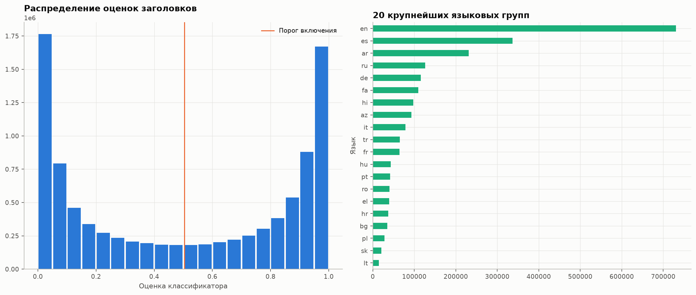

## 5. Концентрация источников и дрейф

В адресах статей обнаружено 6 183 хостов. Эффективное число источников равно 1 / Σ доля². Пять наиболее концентрированных коллекций и коллекция США показывают диапазон этого показателя.

| Коллекция | Хосты | Доля лидера | Доля пяти лидеров | Эффективное число |
| --- | --- | --- | --- | --- |
| bh | 12 | 59,0% | 97,8% | 2,5237 |
| lb | 26 | 53,9% | 88,2% | 2,9658 |
| iq | 16 | 53,5% | 94,5% | 2,8935 |
| ye | 15 | 52,6% | 83,8% | 3,2196 |
| mt | 6 | 51,1% | 99,8% | 2,952 |
| us | 2 867 | 3,0% | 10,1% | 213,6715 |

Наибольшие изменения состава издателей между соседними годами приведены для пар с ≥100 статьями в каждом году. Полная вариация равна половине суммы абсолютных изменений долей хостов. При полном совпадении распределений она равна нулю, при отсутствии общих хостов — единице. 2026 год заканчивается октябрём.

| Коллекция | Первый год | Второй год | Полная вариация |
| --- | --- | --- | --- |
| ve | 2016 | 2017 | 0,8401 |
| ae | 2025 | 2026 | 0,742 |
| lb | 2018 | 2019 | 0,7198 |

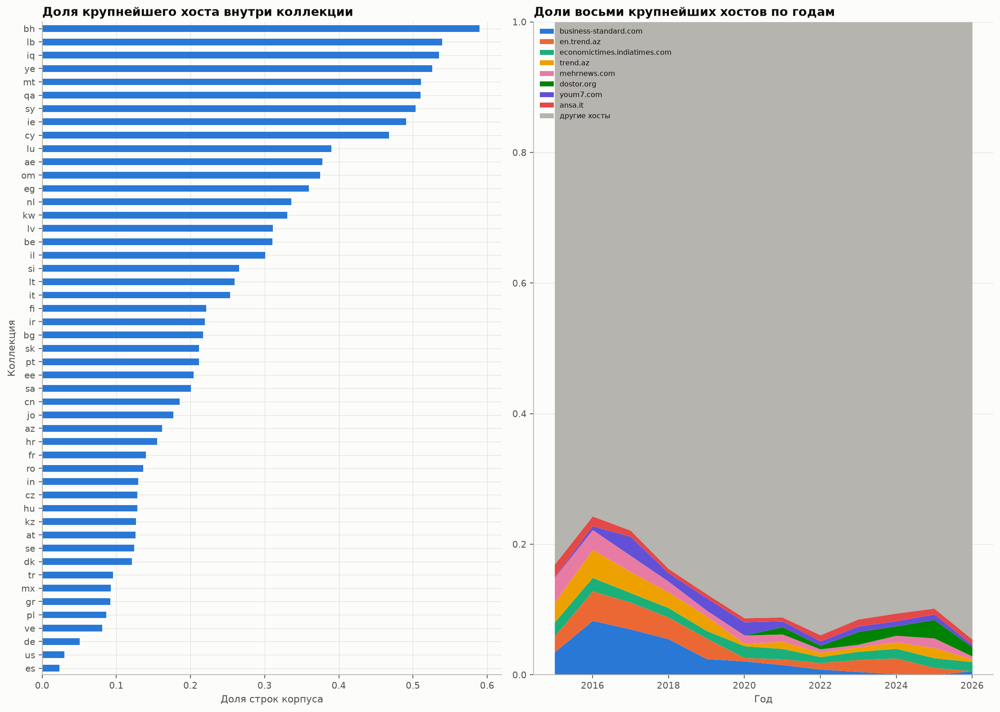

## 6. Качество текстов, дубли и даты

Проверка требует непустого нормализованного заголовка, хеша текста, длины 300–100 000 символов и даты в пределах периода с источником, отличным от unreliable. Предупреждение о содержимом срабатывает на известную заглушку в первых 600 символах или на текст с ≥10 копиями, ≥5 разными заголовками и размахом дат более 30 дней.

| Проверка | Строк или кластеров |
| --- | --- |
| Ненадёжная дата или дата за пределами периода | 1 116 |
| В том числе после конца периода | 878 |
| Длина свыше 100 000 символов | 299 |
| Предупреждение о содержимом | 701 |
| Итоговая и индексная даты расходятся более чем на неделю | 4 113 |
| Ненулевое время суток в итоговой дате | 0 |
| Помечено локальных дублей в коллекциях | 244 730 |
| Избыточные строки по хешу во всём корпусе | 279 721 |
| Кластеры с текстом в нескольких коллекциях | 33 600 |
| Кластеры с допустимыми датами по обе стороны границы 2023 года | 190 |

Если оставить один экземпляр каждого хеша до фильтра качества, число строк сократится на 11,3%. Для графа можно хранить один узел документа и связи со всеми URL, издателями и коллекциями. Это сохраняет историю перепечаток и ограничивает повторный учёт одного сообщения.

| Источник итоговой даты | Строки |
| --- | --- |
| media_cloud | 1 926 433 |
| url | 536 282 |
| page | 13 414 |
| unreliable | 21 |

Расхождение с датой индекса может быть обоснованным исправлением. В таблице ниже приведены наибольшие абсолютные сдвиги среди дат, восстановленных из URL. Числовой идентификатор или часть времени в адресе могут выглядеть как год, месяц и день. Эти случаи нужно сверять с исходной страницей.

| Коллекция | Хост | Дата из URL | Дата индекса | Сдвиг, дни |
| --- | --- | --- | --- | --- |
| lv | rus.delfi.lv | 2010-02-01 | 2025-12-22 | -5 803 |
| mx | vanguardia.com.mx | 2010-06-03 | 2026-04-17 | -5 797 |
| es | abc.es | 2010-06-26 | 2026-03-20 | -5 746 |

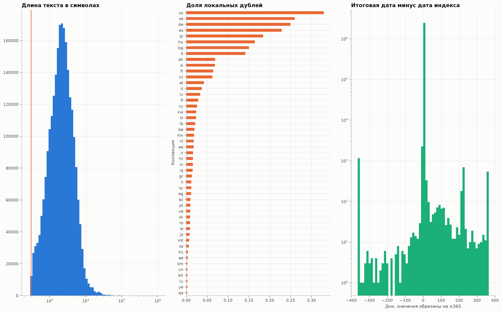

## 7. Темы, кандидаты событий и сущности

| Тема по заголовку | Строки с совпадением |
| --- | --- |
| Цены | 360 714 |
| Перевозки и торговля | 178 544 |
| Геополитика | 95 123 |
| Добыча и производство | 81 721 |
| ОПЕК | 56 758 |
| Трубопроводы | 52 805 |
| Переработка | 43 957 |
| Остановки и аварии | 39 568 |
| Погода | 5 521 |
| Отчётность о запасах | 5 062 |

Тематические группы пересекаются. Среди уникальных текстов, прошедших проверки, у 318 581 (14,5%) есть совпадение по добыче, переработке, перевозкам, трубопроводам, остановкам или погоде без совпадения по отчётности о запасах. Из всех строк корпуса флаг отчётности получили 5 062. Это кандидаты для проверки утечки уже опубликованных данных EIA или API.

Термины отражают язык словаря. Например, правила включают английские и арабские основы, а для китайского отсутствуют иероглифические варианты. Совпадения по странам нельзя напрямую переводить в частоту физических событий.

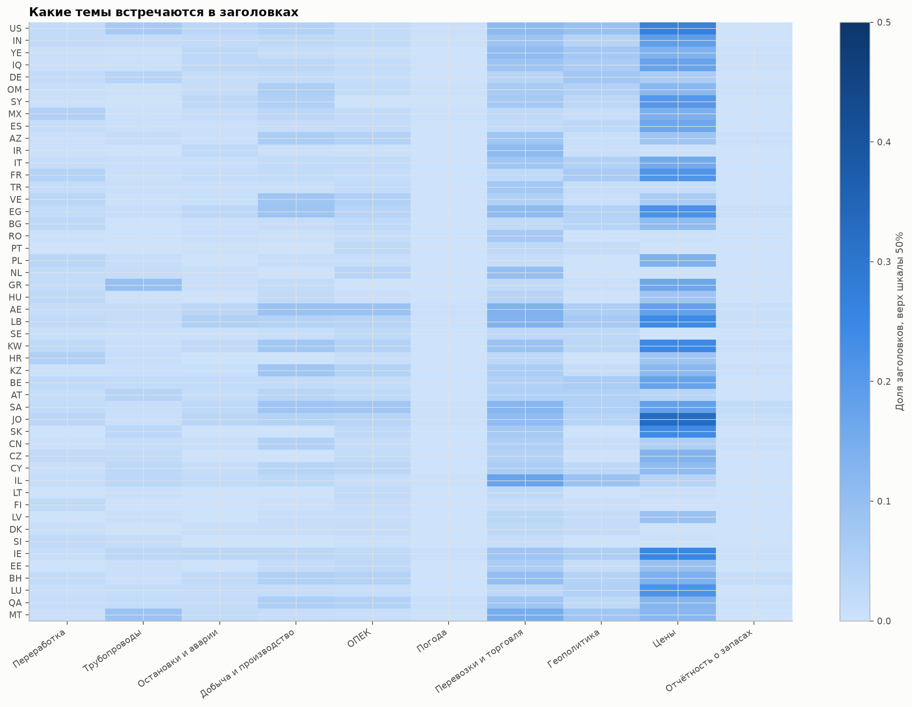

| Группа компаний, мест или обозначений | Заголовки с совпадением |
| --- | --- |
| Pemex / PDVSA | 36 032 |
| Exxon / Chevron | 21 165 |
| Aramco / ADNOC | 18 850 |
| EIA, WTI, SPR и др. | 6 137 |
| Мексиканский залив | 2 227 |
| Permian | 944 |
| Cushing | 52 |

Для связи упоминания с инфраструктурой нужны идентификатор объекта, место и время события, направление воздействия, мощность с единицами и длительность. Одно название компании может относиться к разным объектам.

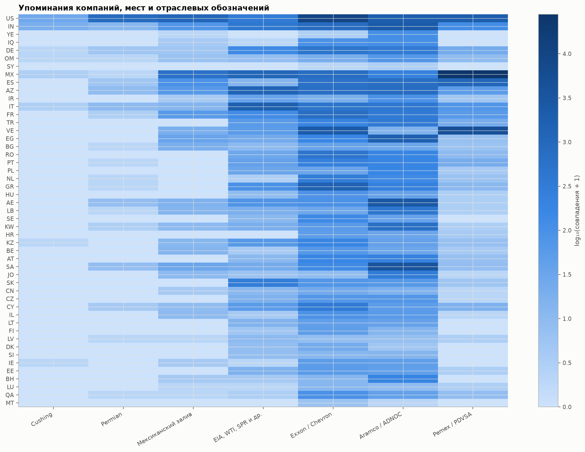

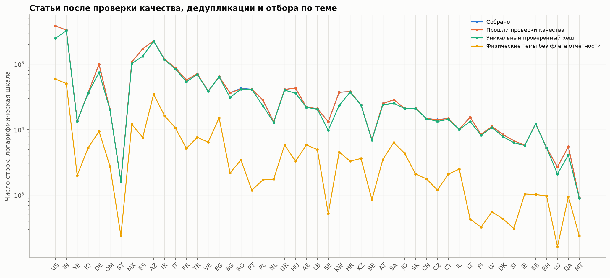

## 8. Привязка к релизам EIA

В календаре 616 наблюдаемых релизов. Публикация относится к первому релизу строго после дня её публикации. Все статьи дня релиза переходят в следующее окно. При точности даты до дня время доступности статьи относительно публикации EIA внутри суток неизвестно. Календарь наследует пропуски 2022 и 2023 годов и задержку релиза в июне 2022 года.

| Коллекция | Период | Релизы | Окна со статьями | Окна с ≥80% попыток | Статьи в окнах |
| --- | --- | --- | --- | --- | --- |
| us | 2015–2022 | 416 | 416 | 416 | 184 985 |
| us | 2023–2026 | 200 | 200 | 200 | 200 626 |
| de | 2015–2022 | 416 | 416 | 416 | 49 406 |
| de | 2023–2026 | 200 | 200 | 200 | 50 374 |
| in | 2015–2022 | 416 | 416 | 416 | 195 310 |
| in | 2023–2026 | 200 | 200 | 200 | 136 374 |
| fr | 2015–2022 | 416 | 416 | 416 | 28 809 |
| fr | 2023–2026 | 200 | 200 | 200 | 28 641 |
| sy | 2015–2022 | 416 | 23 | 369 | 164 |
| sy | 2023–2026 | 200 | 144 | 166 | 1 469 |
| cn | 2015–2022 | 416 | 402 | 416 | 11 736 |
| cn | 2023–2026 | 200 | 199 | 199 | 3 034 |

В первом отчёте в американской коллекции не было текстов для обучения до 2023 года. Теперь статьи есть в 416 из 416 таких окон. Это позволяет проверить модель на более поздних релизах, сохраняя хронологию.

Для статистики оставляем только полные семидневные интервалы [предыдущий релиз, текущий релиз) внутри периода сбора. Из 446 семидневных окон осталось 445. Архив заканчивается 31.10.2026, а последний календарный релиз приходится на 04.11.2026. Первое окно не имеет известной левой границы. При отсутствии попыток наблюдаемое число текстов остаётся пропуском.

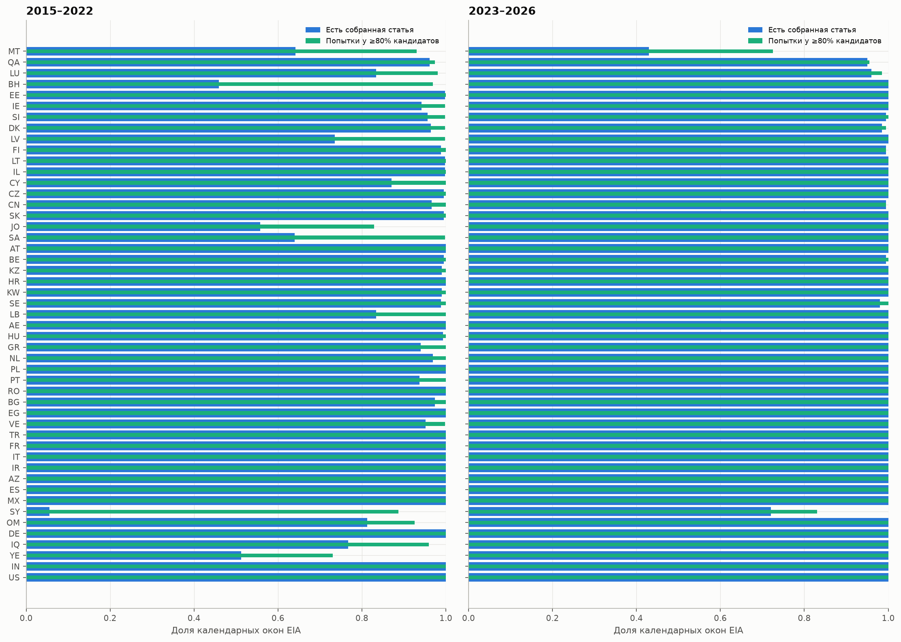

## 9. Количество новостей и сюрприз запасов

Сюрприз запасов равен первой публикации изменения коммерческих запасов нефти США минус консенсус, в млн баррелей. В каждой коллекции проверяем ранговую корреляцию Спирмена с числом собранных статей на полных семидневных окнах. Требуются ≥30 наблюдений. Сравниваем окна с любой попыткой и с попытками у ≥80% кандидатов. Совпадающие наборы дат учитываются один раз при поправке Бенджамини–Хохберга.

Диапазон ρ от -0,073 до 0,053, минимальное скорректированное p = 0,9937. Таблица показывает пять сравнений с наименьшими исходными p.

| Коллекция | Окна | N | ρ | p | p после поправки |
| --- | --- | --- | --- | --- | --- |
| qa | оба порога | 430 | -0,0733 | 0,1289 | 0,9937 |
| eg | оба порога | 445 | 0,0533 | 0,2619 | 0,9937 |
| de | оба порога | 445 | -0,0496 | 0,2964 | 0,9937 |
| om | оба порога | 421 | 0,05 | 0,306 | 0,9937 |
| cy | оба порога | 445 | 0,0463 | 0,33 | 0,9937 |

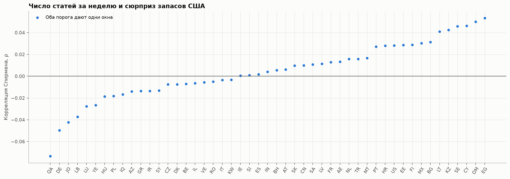

Для отдельной проверки на будущих релизах обучаем методом наименьших квадратов две линейные модели со свободным членом. Первая использует разность API и консенсуса. Вторая добавляет log(1 + число уникальных текстов) и долю этих текстов с физической темой. Счётчики суммируются по коллекциям после глобальной дедупликации. В обеих моделях одинаковые недели со всеми попытками по отобранным кандидатам, хотя бы одним уникальным текстом и известными API, консенсусом и фактом.

| Модель | Недель до 2023 | Недель с 2023 | MAE, млн барр. | RMSE, млн барр. |
| --- | --- | --- | --- | --- |
| API − консенсус | 305 | 140 | 2,7355 | 3,4508 |
| API − консенсус и новости | 305 | 140 | 2,7701 | 3,4973 |

На отложенном периоде с 2023 года добавление двух новостных признаков изменило среднюю абсолютную ошибку на 0,0345 млн баррелей (новая модель минус базовая). Это результат одного временного разбиения для двух агрегатов. Шаблоны и перепечатки определены по всему корпусу, включая последующие публикации. Доступность восстановленных версий текста в момент прогноза документально не установлена.

## 10. Выводы для событийного графа

Самая крупная потеря материала происходит при получении старых страниц. Вместе со счётчиком новостей стоит хранить долю восстановленных публикаций по издателю и месяцу. Это особенно важно для сравнения стран и для периодов, в которых менялся состав источников.

Для ручной проверки сохранена выборка из 616 публикаций. В неё включены случайные строки, заголовки у порога классификатора, сомнительные даты, возможные заглушки и материалы об отчётах. Такая схема отбора помогает разбирать ошибки. Чтобы оценить точность по всему корпусу, нужна независимая выборка с известными вероятностями отбора.

При подготовке исторической оценки переносите копии одного документа в одну выборку, сохраняйте исходную дату и отдельно фиксируйте подтверждённое время доступности. Качество извлечения событий, связей с объектами и прогноза спрэда WTI требует отдельной проверки.

## 11. Воспроизведение и проверки

Запустите из корня репозитория при наличии локальных новостных Parquet и распакованного каталога eda/data/processed из processed.zip.

```bash
.venv/bin/python eda/news_eda.py
.venv/bin/python eda/execute_notebook.py eda/notebooks/08_news_corpus.ipynb
.venv/bin/python -m pytest -q tests/eda/test_news_eda.py
```

Обычный запуск пересчитывает таблицы, графики, Markdown, HTML и JSON. Флаг --cached использует уже рассчитанные таблицы. Производные Parquet, манифест и review_sample.csv находятся в eda/data/derived/news/. Для формирования выборки используется seed 6107. Сводка JSON содержит контрольные суммы модуля анализа, метаданных модели и конфигурации регионов.

В манифесте 17 643 входных Parquet, включая три таблицы календаря и данных EIA, API и консенсуса. Размер и время изменения сверены после анализа. SHA-256 отсортированного перечня путей, размеров, времён и числа строк — c8c87e58710e3601714b21efb063373fcb442b2839572b8bfe9134eafcef13be. Выполнено проверок — 14.

- Число статей совпадает с суммой строк по странам.
- Каждая пара страны и story_id встречается в корпусе один раз.
- Каждая коллекция представлена всеми месяцами периода.
- Сохранённые попытки соответствуют отобранным идентификаторам.
- Число попыток ограничено числом кандидатов.
- Число статей ограничено числом успешных извлечений и попыток.
- Неудачные и успешные попытки в сумме дают все попытки.
- В каждом окне число попыток ограничено числом кандидатов.
- В окнах без попыток число наблюдаемых текстов остаётся пропуском.
- Уникальные тексты удовлетворяют фильтрам качества.
- Хеши отобранных для анализа текстов уникальны.
- День публикации предшествует назначенному релизу.
- Число словарных кандидатов в окне ограничено числом уникальных текстов.
- Сюрприз равен первой публикации факта минус консенсус.
