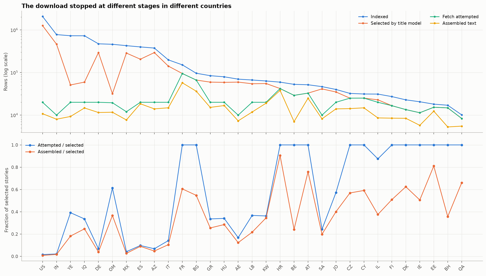
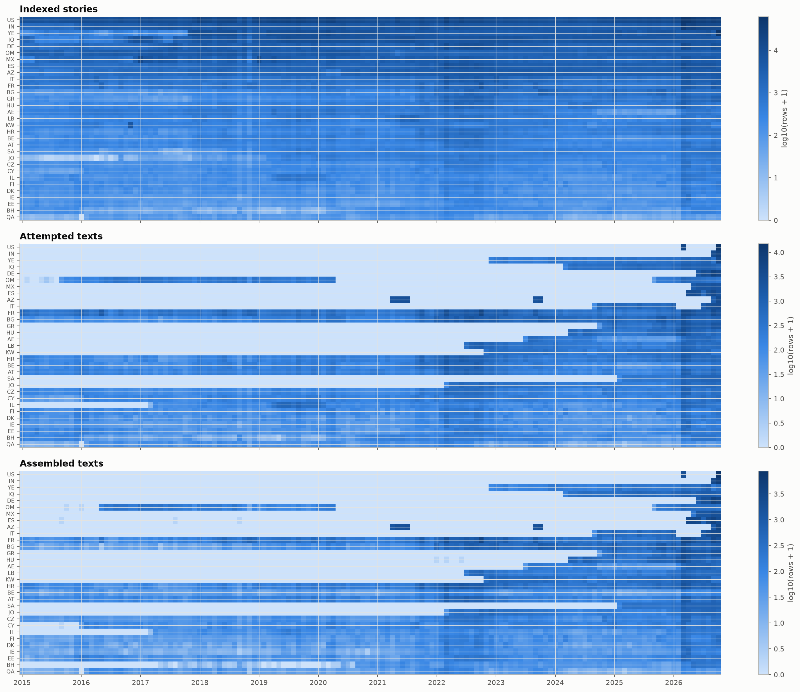
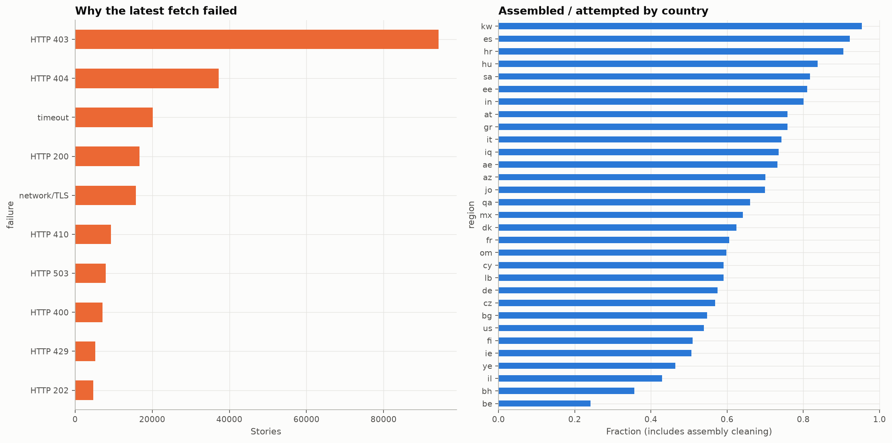
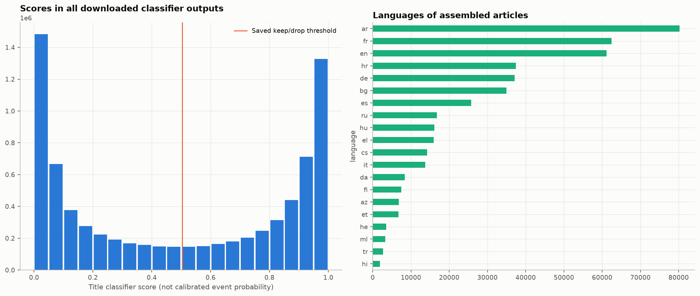
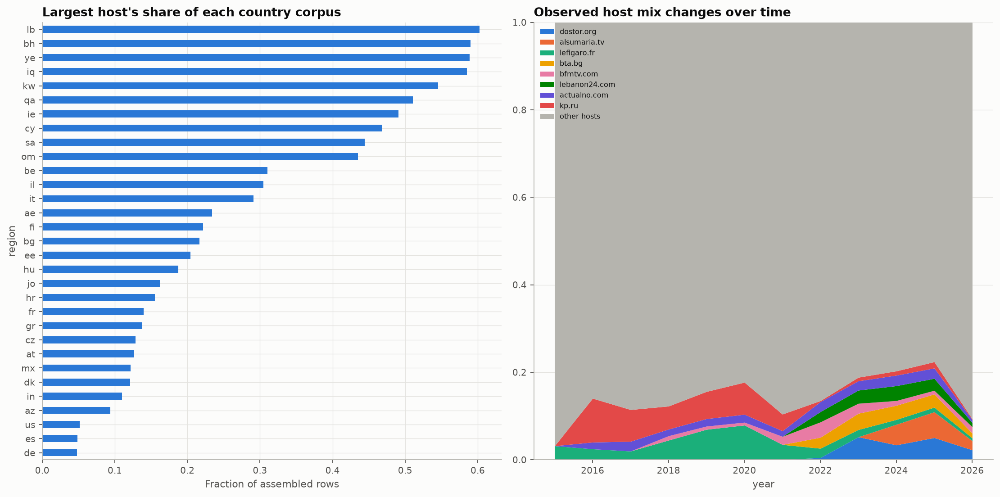
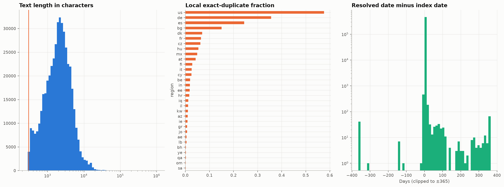
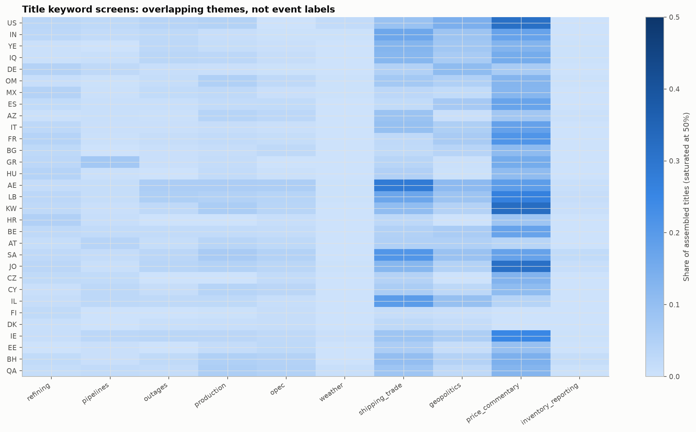
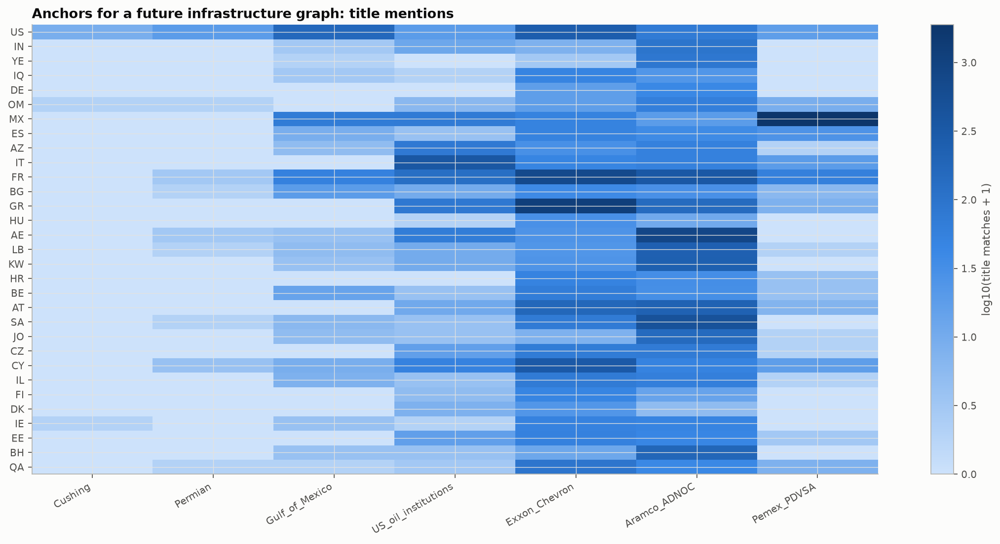
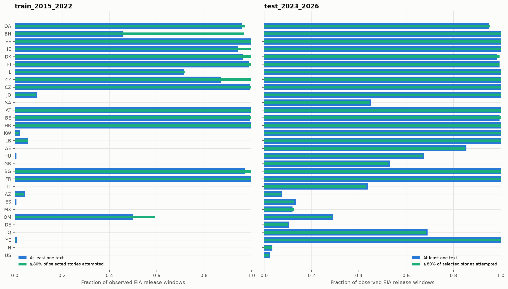
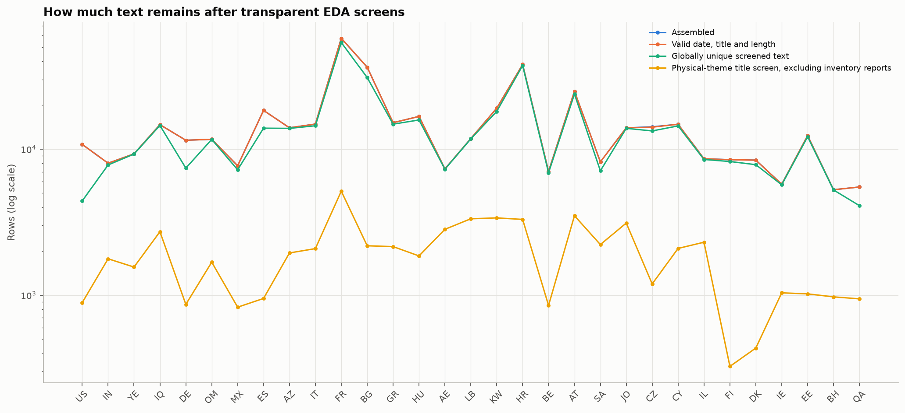

# Разведочный анализ новостного корпуса

Ноутбук: [`08_news_corpus.ipynb`](../eda/notebooks/08_news_corpus.ipynb). Код расчётов: [`news_eda.py`](../eda/news_eda.py). Полный отчёт со встроенными графиками: [`news_eda.html`](../eda/reports/news/news_eda.html).

Документ продолжает [EDA неновостных источников](eda.md) и описывает **локальную многоязычную выгрузку по странам**, а не старый русскоязычный набор из `jup_files/data/02_news_eda.ipynb`. Задача — проверить полноту сбора, качество текстов и дат, возможность привязать новости к релизам EIA и пригодность корпуса для будущего событийного графа.

Все числа относятся к сохранённому результату EDA от **10 ноября 2026 года, 20:00 UTC**. Период аудита — **2015-01-01 — 2026-10-31**, 142 месяца. Сбор был прерван: наличие индекса за весь период не означает наличие полных текстов за все годы. Машиночитаемая сводка сохранена в [`summary.json`](../eda/reports/news/summary.json).

---

## Содержание

1. [Источники и учёт стадий сбора](#1-источники-и-учёт-стадий-сбора)
2. [Географическое и временное покрытие](#2-географическое-и-временное-покрытие)
3. [Ошибки загрузки и смещение выборки](#3-ошибки-загрузки-и-смещение-выборки)
4. [Языки и фильтр релевантности](#4-языки-и-фильтр-релевантности)
5. [Концентрация источников и дрейф](#5-концентрация-источников-и-дрейф)
6. [Качество текстов, дубли и даты](#6-качество-текстов-дубли-и-даты)
7. [Темы, кандидаты событий и сущности](#7-темы-кандидаты-событий-и-сущности)
8. [Привязка к релизам EIA](#8-привязка-к-релизам-eia)
9. [Количество новостей и inventory surprise](#9-количество-новостей-и-inventory-surprise)
10. [Сводные выводы и подготовка к моделированию](#10-сводные-выводы-и-подготовка-к-моделированию)
11. [Воспроизведение и проверки](#11-воспроизведение-и-проверки)

---

# 1. Источники и учёт стадий сбора

Анализ читает сохранённые стадии из `data/raw/news`, `data/interim/news` и `data/processed/news`. Страны и языки задаются в [`src/news/regions.toml`](../src/news/regions.toml). Исходные файлы, результаты классификатора и собранные датасеты при EDA не изменяются.

| Стадия | Строк / текстов | Что считается |
|---|---:|---|
| Индекс Media Cloud | 7 717 903 | записи сохранённого объединённого индекса по странам |
| Кандидаты после фильтра по заголовку | 3 870 772 | записи, отобранные для получения текста |
| Попытки получения текста | 716 710 | уникальные `story_id` с сохранённым результатом попытки внутри каждой страны |
| Извлечённые тексты | 485 371 | успешное извлечение до очистки при сборке |
| Собранный корпус | 460 460 | строки итоговых `oil_news.parquet`, включая отмеченные дубли |
| Тексты после проверок качества | 460 339 | допустимые даты, длина, заголовок и хеш; исключены предупреждения о содержимом |
| Уникальные тексты для проверки | 425 706 | прошедшие проверки строки после глобального удаления точных повторов текста |

Попытка сохранена только для **18.5% кандидатов**. В итоговый корпус вошло **64.2% от числа попыток**. Разница между извлечением и сборкой — **24 911 строк**: эти стадии нельзя смешивать, поскольку сборка дополнительно удаляет шаблонные тексты и мусор.

Числа до глобальной дедупликации складываются по странам. Одна публикация может попасть в несколько коллекций, поэтому количество строк индекса или итогового корпуса не равно числу независимых мировых новостей.



**Итог.** Корпус большой, но основная незавершённая работа — получение текстов уже отобранных кандидатов. Отсутствие попытки загрузки означает неизвестное наблюдение, а не отсутствие новости.

---

# 2. Географическое и временное покрытие

## 2.1. Что выгружено по странам

В конфигурации **49 регионов**, локальный индекс и собранные тексты есть у **31**. У этих 31 регионов сохранены индексные окна за все 142 месяца аудита. Файлы вида `stories_2015-01_2015-03.parquet` покрывают несколько месяцев: считать количество файлов количеством месяцев неверно.

| Страна / регион | Индекс | Кандидаты | Попытки | Собрано | Попытки / кандидаты, % |
|---|---:|---:|---:|---:|---:|
| США (`us`) | 2 074 729 | 1 261 928 | 20 000 | 10 781 | 1.6 |
| Индия (`in`) | 777 158 | 463 120 | 10 000 | 8 010 | 2.2 |
| Йемен (`ye`) | 730 782 | 51 050 | 20 000 | 9 284 | 39.2 |
| Ирак (`iq`) | 729 639 | 59 566 | 20 000 | 14 711 | 33.6 |
| Германия (`de`) | 472 232 | 294 467 | 20 000 | 11 506 | 6.8 |
| Оман (`om`) | 460 419 | 31 840 | 19 507 | 11 678 | 61.3 |
| Мексика (`mx`) | 427 503 | 286 248 | 12 000 | 7 692 | 4.2 |
| Испания (`es`) | 399 158 | 205 583 | 20 000 | 18 430 | 9.7 |
| Азербайджан (`az`) | 375 503 | 293 693 | 20 000 | 14 006 | 6.8 |
| Италия (`it`) | 198 436 | 141 652 | 20 000 | 14 851 | 14.1 |
| Франция (`fr`) | 151 564 | 94 874 | 94 874 | 57 451 | 100.0 |
| Болгария (`bg`) | 96 154 | 66 505 | 66 505 | 36 405 | 100.0 |
| Греция (`gr`) | 84 308 | 59 528 | 20 000 | 15 175 | 33.6 |
| Венгрия (`hu`) | 79 336 | 58 714 | 20 000 | 16 752 | 34.1 |
| ОАЭ (`ae`) | 69 883 | 59 561 | 10 000 | 7 323 | 16.8 |
| Ливан (`lb`) | 66 718 | 54 468 | 20 000 | 11 811 | 36.7 |
| Кувейт (`kw`) | 63 288 | 55 156 | 20 000 | 19 070 | 36.3 |
| Хорватия (`hr`) | 59 430 | 42 002 | 42 002 | 38 014 | 100.0 |
| Бельгия (`be`) | 52 756 | 29 102 | 29 102 | 7 037 | 100.0 |
| Австрия (`at`) | 51 605 | 32 808 | 32 808 | 24 894 | 100.0 |
| Саудовская Аравия (`sa`) | 46 641 | 41 222 | 10 000 | 8 179 | 24.3 |
| Иордания (`jo`) | 40 003 | 34 918 | 20 000 | 13 993 | 57.3 |
| Чехия (`cz`) | 32 333 | 24 999 | 24 999 | 14 222 | 100.0 |
| Кипр (`cy`) | 31 307 | 25 043 | 25 043 | 14 807 | 100.0 |
| Израиль (`il`) | 31 149 | 22 855 | 20 000 | 8 589 | 87.5 |
| Финляндия (`fi`) | 27 210 | 16 637 | 16 637 | 8 471 | 100.0 |
| Дания (`dk`) | 22 826 | 13 463 | 13 463 | 8 409 | 100.0 |
| Ирландия (`ie`) | 20 564 | 11 363 | 11 363 | 5 750 | 100.0 |
| Эстония (`ee`) | 18 093 | 15 274 | 15 274 | 12 380 | 100.0 |
| Бахрейн (`bh`) | 17 052 | 14 801 | 14 801 | 5 274 | 100.0 |
| Катар (`qa`) | 10 124 | 8 332 | 8 332 | 5 505 | 100.0 |

Без локального объединённого индекса остались: **IR, SY, EG, TR, LV, LT, LU, MT, NL, PL, PT, RO, SK, SI, SE, KZ, VE, CN**. Это отсутствие выгрузки в данном снимке, а не нулевой новостной поток этих стран.

В конфигурации Ирак, Оман, Сирия и Йемен используют `full_stream`; остальные регионы — поисковые запросы с терминами для широкого охвата (`recall`). Поэтому доли отбора от индекса имеют разные основания для сравнения: в одном случае фильтруется весь поток коллекции, в другом — уже тематически ограниченный результат поиска.

## 2.2. Почему полный индекс не даёт полного исторического корпуса

Частично обработанные регионы смещены к последним датам: загрузчик начинал с новых публикаций. Например:

- США: тексты только за **2026-03-30 — 2026-10-31**;
- Германия: **2026-06-16 — 2026-10-31**;
- Индия: **2026-09-16 — 2026-10-31**;
- Мексика: **2026-05-25 — 2026-10-31**;
- Италия: **2024-09-24 — 2026-10-31**.

Границы периода не означают непрерывное покрытие между ними. В частности, американский индекс содержит более 2 млн записей, но **обучающего корпуса полных текстов США за 2015–2022 годы в этом снимке нет**.



**Итог.** Нужно отдельно хранить покрытие индекса, отбора, попыток и готовых текстов. Даже 100% попыток среди кандидатов не доказывают полноту архива Media Cloud, полноту поиска или полноту отбора классификатором.

---

# 3. Ошибки загрузки и смещение выборки

Для повторных попыток используется последний сохранённый результат по `story_id` и `fetched_at`, как в загрузчике. После такого учёта найдено **231 339 неудачных попыток извлечения**.

| Причина | Попыток |
|---|---:|
| HTTP 403 | 94 221 |
| HTTP 404 | 37 261 |
| Тайм-аут | 20 187 |
| HTTP 200 без успешного извлечения текста | 16 695 |
| Сетевая ошибка / TLS | 15 791 |
| HTTP 410 | 9 271 |
| HTTP 503 | 7 910 |
| HTTP 400 | 7 079 |
| HTTP 429 | 5 258 |

HTTP 200 сам по себе не означает получение статьи: ответ может содержать страницу согласия, заглушку или документ, из которого текст не извлечён. Отдельно учитываются успешно извлечённые тексты, которые затем не вошли в сборку.

Результат сильно зависит от издателя. В американской коллекции у `reuters.com` **114 895 кандидатов**, но сохранено **75 попыток и 1 собранная статья**. У `indiatimes.com` в индийской коллекции — **75 804 кандидата, 1 569 попыток и 1 558 статей**. Эти примеры показывают две разные причины недостатка текста: незавершённую загрузку и низкую извлекаемость среди уже обработанных URL.



**Итог.** Готовые статьи — выборка, зависящая от доступности сайтов, ошибок извлечения и порядка загрузки. Рост количества полученных текстов нельзя автоматически интерпретировать как рост числа нефтяных событий. Успешная загрузка старого URL в 2026 году также не доказывает, что извлечена исходная историческая версия статьи.

---

# 4. Языки и фильтр релевантности

## 4.1. Языковой состав

В собранном корпусе **29 языков**. Ниже — крупнейшие группы; доля считается от всех 460 460 строк, до глобальной дедупликации.

| Язык | Строк | Доля, % | Медианная длина, символов |
|---|---:|---:|---:|
| Арабский (`ar`) | 80 253 | 17.4 | 1 334 |
| Французский (`fr`) | 62 445 | 13.6 | 2 738 |
| Английский (`en`) | 61 170 | 13.3 | 2 491 |
| Хорватский (`hr`) | 37 435 | 8.1 | 1 975 |
| Немецкий (`de`) | 37 113 | 8.1 | 2 006 |
| Болгарский (`bg`) | 34 996 | 7.6 | 1 472 |
| Испанский (`es`) | 25 734 | 5.6 | 3 258 |
| Русский (`ru`) | 16 804 | 3.6 | 1 228.5 |
| Венгерский (`hu`) | 16 089 | 3.5 | 2 149 |
| Греческий (`el`) | 15 921 | 3.5 | 2 762 |
| Чешский (`cs`) | 14 201 | 3.1 | 2 163 |
| Итальянский (`it`) | 13 768 | 3.0 | 1 698 |
| Остальные 17 языков | 44 531 | — | — |

Страна коллекции не определяет язык статьи. Например, английские тексты встречаются в 24 коллекциях. Сравнение длин ведётся по символам: число слов, разделённых пробелами, менее сопоставимо между письменностями.

## 4.2. Что известно о классификаторе

Сохранённая модель фильтрует **заголовки**, используя `intfloat/multilingual-e5-base`; в метаданных указано **20 068 обучающих примеров**. EDA читает готовые оценки, не запускает энкодер и не обучает модель повторно.

| Метрика из метаданных обучения | Значение |
|---|---:|
| PR-AUC | 0.973 |
| PR-AUC, среднее по языкам | 0.959 |
| PR-AUC с весами страт | 0.532 |
| PR-AUC на временной проверке | 0.970 |

Это метрики разработки модели, **не проверка точности на текущем корпусе**. Разрыв между обычной и взвешенной PR-AUC показывает, что вывод чувствителен к составу выборки.

Пороги `keep` и `drop` совпадают: **0.503766**. Поэтому сохранённые решения бинарные; пограничных решений (`borderline`) нет. Оценку модели нельзя трактовать как откалиброванную вероятность физического события.



**Итог.** Для оценки precision и recall на этой выгрузке нужна ручная разметка. Сохранённые метрики обучения не заменяют проверку по языкам, странам и типам текстов текущего корпуса.

---

# 5. Концентрация источников и дрейф

В корпусе встречаются **2 732 хоста**, но некоторые коллекции зависят от нескольких сайтов. Эффективное число источников рассчитывается как:

```text
effective_sources = 1 / sum(host_share²)
```

Если все сайты имеют одинаковый вес, оно равно их количеству. При доминировании нескольких сайтов оно существенно меньше. Доли ниже рассчитаны по собранным строкам до глобальной дедупликации.

| Коллекция | Хостов | Доля крупнейшего, % | Доля пяти крупнейших, % | Эффективное число |
|---|---:|---:|---:|---:|
| Ливан | 21 | 60.3 | 89.8 | 2.5 |
| Бахрейн | 12 | 59.0 | 97.8 | 2.5 |
| Ирак | 12 | 58.5 | 98.2 | 2.5 |
| Кувейт | 6 | 54.6 | 97.7 | 2.7 |
| Франция | 223 | 14.0 | 36.9 | 20.8 |
| Германия | 116 | 4.8 | 21.2 | 46.3 |
| США | 936 | 5.2 | 8.6 | 172.7 |

Большое число американских хостов не означает столько же независимых сообщений: один агентский текст перепечатывается десятками станций. Концентрацию источников нужно рассматривать вместе с дублями.

Состав издателей меняется со временем. Полная вариация распределения весов хостов (`total_variation`, от 0 до 1) между соседними годами достигает **0.742 для ОАЭ в 2025–2026**, **0.632 для Омана в 2017–2018** и **0.615 для Кипра в 2021–2022**. Срез 2026 года заканчивается октябрём, поэтому годовые суммы не полностью сопоставимы.



**Итог.** Изменение частоты тем может отражать смену сайтов в архиве и успешности загрузки. Для временной проверки нужно контролировать состав источников, а влияние новостных перепечаток отделять от числа событий.

---

# 6. Качество текстов, дубли и даты

## 6.1. Проверки качества

Первичный фильтр требует непустой нормализованный заголовок, хеш текста, длину **300–100 000 символов**, дату в пределах аудита и `date_source != unreliable`. Ему соответствуют **460 429 строк**. После исключения предупреждений о содержимом остаются **460 339**, после глобальной дедупликации — **425 706**.

| Проверка | Результат |
|---|---:|
| Дата вне периода или помечена ненадёжной | 17 строк |
| Из них дата позже 2026-10-31 | 1 строка |
| Текст длиннее 100 000 символов | 14 строк |
| Предупреждение о шаблоне / содержимом | 90 строк |
| Расхождение итоговой и индексной даты более 7 дней | 677 строк |
| Сохранённое время публикации точнее дня | 0 строк |

Предупреждения о содержимом ищут узнаваемые заглушки в первых 600 символах, а также один текст под не менее чем 5 разными заголовками, повторённый не менее 10 раз за период более 30 дней. Пороговые правила служат для проверки и не являются обученными метками качества.

Конкретный пример — текст согласия на рекламу iDNES: **73 строки, 73 разных заголовка, 57 хостов**, даты с 2015 по 2024 год. Очистка шаблонов отдельно по хостам пропускает один и тот же шаблон на множестве поддоменов.

## 6.2. Точные повторы и утечка между выборками

| Показатель | Результат |
|---|---:|
| Строки с локальной отметкой `duplicate_of` | 30 918 |
| Лишние строки по глобальному хешу полного текста | 34 717 |
| Кластеры одинакового текста в нескольких странах | 3 743 |
| Кластеры одинакового текста по обе стороны границы 2023 года | 28 |

Локальные отметки, глобальные повторы и повторы среди прошедших проверки строк имеют разные основания подсчёта; их нельзя складывать. В США локальная доля отмеченных дублей — **57.6%**. Среди крупнейших американских кластеров один текст встречается на **94 хостах**.

Для графа точный текст должен становиться одним документом, а URL, издатели и коллекции — сохраняться как его происхождение. Дубликаты нужно учитывать до оценки на временных разбиениях: одинаковое содержимое не должно одновременно попадать в обучение и проверку. Совпадение заголовка само по себе не основание для удаления — оно может обозначать регулярные обновления.

## 6.3. Откуда берётся дата

| Источник итоговой даты (`date_source`) | Строк |
|---|---:|
| `media_cloud` | 367 929 |
| `url` | 90 056 |
| `page` | 2 474 |
| `unreliable` | 1 |

Дата из URL не является эталоном. В примерах из испанской коллекции URL содержит `20260420130606`, а итоговая дата ошибочно становится **2013-06-06** вместо индексной **2026-04-20**. Числовые идентификаторы и время в конце URL могут случайно соответствовать шаблону даты. Ошибочный, но правдоподобный год не всегда выявляется проверкой границ периода.

Расхождение дат более недели сохранено как признак для ручного разбора, а не автоматического удаления: часть исправлений может быть обоснованной. Значение `date` во всех строках имеет точность до дня; это не доказывает, что время отсутствует на исходной странице, но не позволяет использовать его для внутридневного отсечения в текущем анализе.



**Итог.** Корпус пригоден для дальнейшего изучения после явных проверок. Для исторической модели ещё нужны исправление определения дат, проверка шаблонов и контроль общих текстов между разбиениями. Статус «прошёл фильтр» не означает, что статья уже готова к моделированию.

---

# 7. Темы, кандидаты событий и сущности

## 7.1. Что найдено в заголовках

Для поиска примеров использованы прозрачные многоязычные словари. Они допускают пересечения; числа ниже относятся ко **всем собранным строкам**, включая повторы. Один заголовок может входить в несколько тем.

| Словарная тема | Совпадений |
|---|---:|
| Цены и рыночные комментарии | 68 323 |
| Перевозки, экспорт и импорт | 31 322 |
| Геополитика | 21 236 |
| Нефтепереработка | 12 139 |
| Добыча и производство | 11 435 |
| ОПЕК | 9 012 |
| Остановки, аварии и обслуживание | 6 911 |
| Трубопроводы | 6 290 |
| Отчёты о запасах, EIA и API | 1 098 |
| Погода | 759 |

После проверок качества и глобальной дедупликации **59 473 текста**, или **14.0% от 425 706**, имеют хотя бы одно совпадение по добыче, переработке, трубопроводам, остановкам, погоде или перевозкам и не имеют совпадения по отчётности о запасах. Это **кандидаты для проверки физических событий**, а не извлечённые и подтверждённые события.

Словари покрывают языки неравномерно. Сравнивать по ним истинную частоту событий в разных странах нельзя; отсутствие ключевого слова в заголовке не означает отсутствие события в тексте.

Отдельной проверки на утечку требуют **1 098 совпадений по отчётам о запасах**. Статья может уже сообщать результат EIA/API. При этом публикация об API до EIA может содержать допустимую информацию — решение зависит от времени доступности и постановки прогноза. Один словарный флаг этого не определяет.



## 7.2. За что можно привязать новость к графу

| Группа упоминаний в заголовках | Строк с совпадением |
|---|---:|
| Aramco / ADNOC | 3 734 |
| Exxon / Chevron | 3 609 |
| Pemex / PDVSA | 2 066 |
| Нефтяные институты и обозначения США: EIA, WTI, SPR и др. | 956 |
| Мексиканский залив | 372 |
| Permian | 30 |
| Cushing | 10 |

Здесь также учитываются все собранные строки до глобальной дедупликации. Это совпадения с группами словаря, а не число уникальных компаний, объектов или событий.



Название компании или региона даёт начало для связывания с инфраструктурой из неновостной EDA, но ещё не идентифицирует конкретный НПЗ, месторождение или участок трубопровода. **Страна Media Cloud — страна коллекции источников, а не место события**: американский сайт может писать о Саудовской Аравии и наоборот.

Для будущего события нужно извлечь и проверить место, объект и его идентификатор, время события, время публикации и доступности, направление воздействия, мощность с единицами измерения и длительность. Неоднозначные связи с объектами нужно сохранять отдельно, с оценкой уверенности.

**Итог.** В корпусе есть материал для событийного графа, но качество распознавания событий и связывания сущностей пока не измерено. Частоты слов не заменяют разметку событий и физических последствий.

---

# 8. Привязка к релизам EIA

## 8.1. Временное правило

Для разведочной привязки статья относится к **первому наблюдаемому релизу Myfxbook EIA строго после дня её публикации**:

```text
publication_day < release_date
```

Все статьи дня релиза переходят к следующему наблюдаемому релизу: сохранённая точность даты не позволяет установить, появились ли они до 10:30 ET. Такое правило консервативно по дате публикации, но не подтверждает, что историческая версия текста и исправленная дата действительно были доступны на момент прогноза.

Календарь содержит **616 релизов**: **416 до 2023 года** и **200 начиная с 2023 года**. Он наследует ограничения неновостной EDA: пропущенные недели в 2022 и 2023 годах и неоднозначную задержанную публикацию июня 2022 года. Отсутствующие релизы и консенсусы не восстанавливались искусственно.

У первого окна неизвестно начало. Из-за переносов и пропусков релизов окна не всегда равны семи дням; их длительность сохраняется явно. Для корреляционного анализа используются только **7-дневные окна**, которых в календаре **446**.

## 8.2. Где есть историческая выборка

Ниже — примеры из таблицы `release_coverage.parquet`. Числа обозначают окна релизов, а не количество статей. У обучающего периода 416 окон, у проверочного — 200.

| Коллекция | Период | Окон с попытками | Окон с текстами | Окон с попытками для ≥80% кандидатов |
|---|---|---:|---:|---:|
| США | 2015–2022 | 0 | 0 | 0 |
| США | 2023–2026 | 5 | 5 | 4 |
| Германия | 2015–2022 | 0 | 0 | 0 |
| Германия | 2023–2026 | 21 | 21 | 20 |
| Индия | 2015–2022 | 0 | 0 | 0 |
| Индия | 2023–2026 | 7 | 7 | 7 |
| Франция | 2015–2022 | 416 | 416 | 416 |
| Франция | 2023–2026 | 200 | 200 | 200 |
| Австрия | 2015–2022 | 416 | 416 | 416 |
| Австрия | 2023–2026 | 200 | 200 | 200 |
| Хорватия | 2015–2022 | 416 | 416 | 416 |
| Хорватия | 2023–2026 | 200 | 200 | 200 |
| Болгария | 2015–2022 | 416 | 405 | 416 |
| Болгария | 2023–2026 | 200 | 200 | 200 |
| Азербайджан | 2015–2022 | 18 | 18 | 16 |
| Азербайджан | 2023–2026 | 15 | 15 | 14 |

Порог 80% показывает степень обработки выбранных кандидатов и используется для проверки чувствительности. Он не означает 80% всех новостей и не гарантирует успешного извлечения текстов.

В недельной таблице сохраняются отдельные счётчики `indexed`, `candidates`, `attempted`, `assembled`, доля попыток и состояние покрытия. **`observed_text_count` остаётся пропуском, если попыток не было**. Это отличает неизвестную неделю от обработанной недели, в которой не удалось получить тексты.

Стадии до сборки привязаны к исходной дате индекса, а готовый текст — к итоговой дате. Исправление даты может переместить статью между окнами. Например, в Испании и Венгрии по три старых окна содержат тексты при отсутствии попыток, отнесённых к этим окнам по индексной дате. Поэтому отношения недельных счётчиков — диагностика, а не точная вероятность извлечения одних и тех же статей внутри окна.



**Итог.** Текущий снимок позволяет исследовать длинные ряды некоторых европейских коллекций. Для исторической модели на американских полных текстах нужно сначала догрузить прошлые годы и проверить временную доступность статей.

---

# 9. Количество новостей и inventory surprise

Проверена описательная связь между количеством собранных статей в стране перед релизом и целевой переменной:

```text
surprise_mmbbl = actual_mmbbl − consensus_mmbbl
```

Использована корреляция Спирмена в 7-дневных окнах с известным таргетом. Для каждой страны проверены два варианта: любые окна с попытками и окна, где обработано не менее 80% кандидатов. Требуется не менее 30 наблюдений и изменяющееся количество статей. Счётчик `assembled` на этом этапе **включает дубли**; это не число уникальных событий.

Всего получилось **50 сравнений**. Поправка Бенджамини — Хохберга применена ко всей семье сравнений, чтобы контролировать долю ложных открытий. Примеры результатов:

| Коллекция | Покрытие | Наблюдений | ρ Спирмена | Исходное p | p после поправки |
|---|---|---:|---:|---:|---:|
| Франция | есть попытки | 446 | 0.011 | 0.824 | 0.977 |
| Австрия | есть попытки | 446 | 0.005 | 0.923 | 0.977 |
| Болгария | есть попытки | 446 | 0.030 | 0.525 | 0.977 |
| Ирак | есть попытки | 101 | 0.059 | 0.557 | 0.977 |
| Катар | есть попытки | 431 | −0.074 | 0.127 | 0.977 |
| Йемен | есть попытки | 144 | 0.107 | 0.203 | 0.977 |
| Италия | попытки для ≥80% кандидатов | 59 | −0.090 | 0.498 | 0.977 |

**Ни одно из 50 сравнений не проходит порог 5% после поправки.** Диапазон корреляций — примерно **от −0.090 до 0.107**, минимальное исходное p — **0.127**. В этом анализе нет убедительного свидетельства связи простого количества публикаций с сюрпризом запасов.



Это описательная проверка по доступным окнам, а не обучение модели с проверкой на будущих данных. Она не измеряет прирост качества от событийного графа и не учитывает всю информацию текста. Даже значимая корреляция сама по себе не доказывала бы полезность сверх API.

В [неновостной EDA](eda.md) признак `API − консенсус` объяснял около **51% дисперсии сюрприза**. Поэтому будущую новостную модель нужно сравнивать с базовой моделью, включающей API, консенсус и доступные до релиза фундаментальные признаки.

**Итог.** Счётчик публикаций пока не даёт подтверждённого сигнала. Проверка содержательных событий и связей между объектами остаётся отдельной задачей.

---

# 10. Сводные выводы и подготовка к моделированию

| Наблюдение | Измеренный результат | Следствие |
|---|---|---|
| Масштаб корпуса | 460 460 строк, 29 языков, 31 коллекция | материала достаточно для изучения текстов и ручной проверки |
| Незавершённая загрузка | попытки только для 18.5% кандидатов | неизвестное покрытие нельзя кодировать нулём событий |
| Американская история | нет текстов за 2015–2022, только 5 окон с текстами в 2023–2026 | историческое обучение на полных текстах США пока не обеспечено |
| Повторы | 34 717 лишних строк по глобальному хешу, 28 кластеров пересекают границу 2023 года | нужны единые документы и контроль дублей между разбиениями |
| Даты | 17 ненадёжных / вне периода, 677 расхождений более недели, нет точного времени | нужны исправление дат и доказательство доступности до отсечения |
| Кандидаты физических событий | 59 473 уникальных текста после проверок | есть выборка для разметки, точность извлечения пока не измерена |
| Простой новостной поток | 0 из 50 значимых сравнений после поправки | полезность количества статей для сюрприза не подтверждена |

## Что нужно сделать перед моделированием

1. **Исправить определение даты.** Воспроизвести найденные ошибки разбора URL тестами, сохранять исходную и исправленную даты и причину изменения. Пересобрать данные после проверки исправления.
2. **Догрузить историю.** Использовать помесячный учёт и таблицы издателей, начиная с американского обучающего периода и крупных недообработанных источников. Не заменять необработанные месяцы нулями.
3. **Разметить примеры вручную.** Подготовлен `eda/data/derived/news/review_sample.csv` на **366 строк** с пустыми полями для релевантности, типа события, корректности даты, качества текста и комментария. Выборка обогащена сложными случаями и не является вероятностной выборкой для оценки точности по всему корпусу.
4. **Сформировать документы и происхождение.** Объединять точные тексты, сохраняя связи со всеми URL, издателями и коллекциями. Отдельно изучить близкие повторы и варианты обновлённых статей.
5. **Проверить извлечение событий и сущностей.** Отделить физические события от ценовых комментариев и сообщений о результатах EIA/API; определить место события независимо от страны коллекции и связать объекты с инфраструктурными справочниками.
6. **Зафиксировать момент прогноза.** Для каждого документа и признака проверять `available_at < prediction_timestamp`, учитывая версию текста, точность времени и исправления дат.
7. **Измерить прирост на временной проверке.** После проверки покрытия и утечек сравнить новости и граф с базовой моделью на API, консенсусе и доступных фундаментальных данных. Использовать последовательную проверку по времени и учитывать смену источников.

## Что пока не проверено

- Precision и recall фильтра релевантности на текущем корпусе, а также качество словарных кандидатов событий.
- Точность связывания компаний, мест и объектов с инфраструктурными таблицами.
- Полнота исходного архива Media Cloud и полнота тематических запросов.
- Историческая доступность именно той версии текста, которая извлечена при загрузке.
- Прирост качества прогноза сюрприза или спрэда WTI от новостей и событийного графа.

---

# 11. Воспроизведение и проверки

Запуск из корня репозитория:

```bash
# Полный пересчёт по локальным данным
MPLCONFIGDIR=/tmp/oil-news-matplotlib .venv/bin/python eda/news_eda.py

# Перестроение HTML и рисунков по сохранённым таблицам
MPLCONFIGDIR=/tmp/oil-news-matplotlib .venv/bin/python eda/news_eda.py --cached

# Проверки календарных границ и учёта источников
.venv/bin/python -m pytest tests/eda/test_news_eda.py
```

Анализ работает без сети, скачивания статей, GPU и платной разметки; страны читаются последовательно. Для календаря EIA нужна распакованная папка `eda/data/processed/`, описанная в [`eda/README.md`](../eda/README.md). Производные таблицы и CSV находятся в `eda/data/derived/news/` и исключены из Git. Для свежего расчёта после новых загрузок или изменения логики нужен запуск **без `--cached`**.

В сохранённом запуске пройдены **11 проверок**:

- суммы собранных строк по странам совпадают с таблицей статей;
- нет повторов пары `(region, story_id)` внутри собранного снимка;
- для каждого региона есть все 142 строки помесячного аудита;
- число попыток не превышает число кандидатов;
- число собранных строк не превышает число уникальных попыток;
- в недельных окнах число обработанных кандидатов не превышает число выбранных;
- у недель без попыток `observed_text_count` остаётся пропуском;
- отобранные для проверки тексты удовлетворяют фильтрам качества;
- хеши текстов после глобальной дедупликации уникальны;
- день публикации строго предшествует назначенному релизу;
- сохранённый сюрприз равен факту минус консенсус.

Манифест охватывает **6 658 входных файлов**. За время сохранённого анализа изменения входов не обнаружены. Начальное значение генератора случайных чисел — **6107**. В сводке записаны хеши кода анализа, модели, конфигурации регионов и манифеста. Хеш манифеста считается по путям, размерам, времени изменения и числу строк, а не по полному содержимому файлов.

## Графики

Все десять рисунков взяты из сохранённых результатов `eda/reports/news/`: они используются в HTML-отчёте и выполненном ноутбуке `08_news_corpus.ipynb`. Для этого документа графики заново не строились. После обновления корпуса Markdown нужно сверять с новым результатом EDA отдельно.
